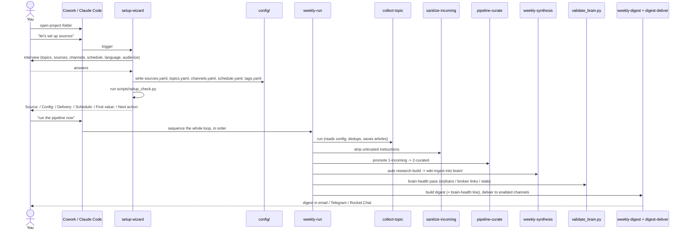

# Quickstart

> 🌐 [Краткий старт по-русски](QUICKSTART.ru.md) — полная документация ведётся на английском.

> **Before you begin.** **Cowork** / **Claude Code** is the assistant that runs this
> project for you — you talk to it in plain language and it does the work. Install it
> once: **[claude.com/product/claude-code](https://www.claude.com/product/claude-code)**.
> The simplest path needs **no terminal and no coding** — you just open this project's
> folder in the assistant and talk to it. (Optional: **[Obsidian](https://obsidian.md)**
> if you later want to browse the knowledge graph as a notebook.)

Get a working research-brain in a few minutes. Follow the **Happy path** below — the
recommended **full agentic** setup where every step is something you *say* to the
assistant. **RSS Digest Lite** and other headless transports live in the
**[Advanced](#advanced--only-for-email-or-cron)** section as a reduced fallback, so you can
ignore them until you need them.

---

## What you need (one-time)

Very little — and **almost no keys to type anywhere.** Email needs none; Telegram's
happy path sets its bot token up through the plugin's own flow (not a file). Only the
headless/cron route puts a token in a file — most people never touch it.

**Required**
- **Cowork or Claude Code** — the assistant that runs everything for you. Install it once:
  **[claude.com/product/claude-code](https://www.claude.com/product/claude-code)**. This is
  the only app you install; the project itself is just a folder you open.
- **This project's folder** — unzip the archive you were sent (Step 1 below).
- **Python 3.11+** on your computer — the behind-the-scenes scripts use it. You don't set
  this up by hand: the assistant runs a one-time installer for you (Step 1). Most Macs and
  Linux machines already have Python.

**To deliver the digest automatically, add the channel(s) you want:**
- **Email** — connect **Gmail** in your assistant (a one-click "connect account"; no
  password to paste).
- **Telegram** — whoever installs this sets the bot up once; then you (and your phone) can
  receive digests and trigger runs. See **Connect Telegram** below.

**Optional**
- **[Obsidian](https://obsidian.md)** (≥1.7) — only if you want to browse the knowledge base
  as a notebook. The digest does not need it.

> **No passwords in files on the happy path.** Email connects through your assistant's
> one-time account connection, and Telegram's bot token is saved by the **plugin's own
> setup** (`telegram:configure`) — not by hand-editing the project. The only place a token
> goes in a file is the command-line / server route in
> [Advanced](#advanced--only-for-email-or-cron), which most people never touch.

---

## Step 1 — unpack the archive and open the folder

1. **Unzip** the archive you received. You get a folder (e.g. `research-brain`).
2. **Open that folder** in Cowork / Claude Code — *File → Open folder*, or drag the folder
   onto the app. The assistant reads it and is ready.
3. **Say to the assistant:** *"install and set up this project."* It runs the one-time
   installer (`./install.sh` — sets up the behind-the-scenes Python bits) and then the
   **setup wizard** that asks you about topics, sources, and channels.

That is the whole install — no cloning, no copying keys. From here, follow the
**[Happy path](#happy-path-no-terminal)**.

> **Terminal users / servers only:** instead of step 3 you can open a terminal in the folder
> and run `./install.sh` yourself (dependencies only; add `--configure` to also run the
> terminal config interview). Skip this unless you specifically want the command-line or
> scheduled-cron route — see [Advanced](#advanced--only-for-email-or-cron).

---

## Pick your path — choose one

There's exactly one happy path for you; ignore the other.

- **🗣️ I'll talk to the assistant (recommended, no terminal).** You already have the
  project folder open in Cowork / Claude Code. **Stay on this page** and follow the
  **[Happy path](#happy-path-no-terminal)** below — every step is something you *say*; you
  never type a shell command or clone anything.
- **⌨️ I prefer the terminal.** After unzipping the archive, run the one-button installer
  in the folder: `cd research-brain && ./install.sh --configure` (it bootstraps uv, builds
  the venv, then runs the interactive configurator; without the flag it installs the
  dependencies only). That path and the cron/headless details are covered in the
  project [README](README.md#fastest-start) and the **[Advanced](#advanced--only-for-email-or-cron)**
  section here. The spoken steps below still read as useful background.

---

## First run at a glance



---

## Happy path (no terminal)

Four steps, all spoken to the assistant. By the end you have your first digest.

### 1. Open the folder and set up sources

Open this project's folder in **Cowork** or **Claude Code**, then in the chat say:

> **let's set up sources**

This triggers the **`setup-wizard`**. It interviews you through six short steps — and
to skip hunting for feeds, it can drop in a ready-made **starter pack** (the bundled
`tech-news` / `ai-ml` topics with real RSS feeds) as your starting point:

1. **Topics** — short names for what you want to track (e.g. `ai-agents`, `markets`).
2. **Sources** — URLs per topic; the wizard detects the type and confirms, and asks how
   much to trust each one (high / medium / low).
3. **Delivery channels** — pick any of email / Telegram / Rocket.Chat.
4. **Schedule** — how often to collect and when to send the digest.
5. **Language** — what language the digest is written in (default `en`).
6. **Audience level** — how technical the digest reads (`technical` / `balanced` /
   `non-technical`).

It writes all the config files for you (you never hand-edit anything), and **no passwords
are stored**. At the end it runs `scripts/setup_check.py` and shows an activation
checklist:

- `Source:`
- `Config:`
- `Delivery:`
- `Schedule:`
- `First value:`
- `Next action:`

This sends nothing. It tells you whether setup is `complete`,
`ready_schedule_not_registered`, or `needs_attention`. If the recurring run has not been
registered yet, the next action is to register one recurring run for
`schedule/weekly-run.md`; config files alone are not final setup completion. That
registration is one command — `python3 scripts/install_schedule.py --path claude --apply`
(see [H. Schedule it](#h-schedule-it-external-cron)).

> **Re-run it anytime to change one thing:** *"reconfigure delivery — turn on
> Rocket.Chat"* or *"add a topic"*.

> **After setup, just talk to it.** Change what's watched by saying it — *"start
> monitoring AI agents"*, *"watch this blog: https://…"*, *"pause this source"*
> (`source-manage`). Ask about its own state — *"what are we monitoring?"*, *"key findings
> this week"* (`brain-ask`). Or get a digest right now — *"build a digest"*
> (`digest-build`). Run the whole cycle now — *"run the pipeline now"* (`run-now`). Or just
> see what it can do — *"what can you do?"* (`capabilities`).

### 2. Connect Telegram (optional, but the friendliest channel)

Want the digest in Telegram — plus the `/digest`, `/run`, … quick commands? Three things:

1. **Create the bot.** Open [@BotFather](https://t.me/BotFather) in Telegram → send
   `/newbot` → choose a display name and a username → copy the **token** it gives you (it
   looks like `123456:ABC-DEF...`). The token is a **secret** — do **not** paste it into this
   chat. It is saved by the **plugin's own setup**: run `telegram:configure` (say
   *"configure Telegram"* or paste the token there). The plugin stores it itself — there is
   **no file to edit**. The setup-wizard wires up everything else but never asks for or
   stores the token.
2. **Get your `chat_id` the easy way.** Message [@userinfobot](https://t.me/userinfobot)
   in Telegram — it instantly replies with your numeric id. Give that id to the wizard (or
   tell the assistant *"my Telegram chat id is …"*); it is not a secret. *(There's also a
   URL method for advanced/headless setups — see the [Advanced](#advanced--only-for-email-or-cron)
   section.)*
3. **Start the session so the bot can answer.** For the bot to *reply* to commands (not
   just receive digests), the session must be started with the inbound channel on. The
   shipped launcher does it all — from the project folder run:

   ```bash
   make telegram
   ```

   (or directly: `scripts/telegram-launch.sh`). It resolves the project folder by itself —
   **nothing to edit** — sets the per-project `TELEGRAM_STATE_DIR`, and starts `claude`
   with the inbound `--channels` flag, so the bot actually listens. Plain `claude` is
   **send-only** (digests arrive, but the bot never answers `/save`, `help`, …).

   Prefer a one-word command from anywhere? Add a thin alias to your shell rc
   (`~/.zshrc` / `~/.bashrc`) — the `setup-wizard` offers to append it for you:

   ```bash
   alias claude-telegram='~/projects/research-brain/scripts/telegram-launch.sh'
   # ⬆️ use YOUR install path (run `pwd` in the project folder to copy it)
   ```

   The full architecture (per-project bots, `TELEGRAM_STATE_DIR` setup) is in
   [docs/telegram-multiproject.md](docs/telegram-multiproject.md).

> **⚠️ Bot never replies, but digests still arrive?** This is almost always one of two
> things, and the fix for both is to launch with **`make telegram`**:
>
> 1. **The session was started with plain `claude`** — it receives nothing inbound, so
>    the bot can send but never answer.
> 2. **Another project owns the bot** — a bot can have only **one live listener at a time**
>    (a Telegram limit), and the newest session to connect *steals* it. Give each project
>    its own bot via a per-project `TELEGRAM_STATE_DIR` (the launcher derives one from the
>    folder name automatically).
>
> Full architecture: [docs/telegram-multiproject.md](docs/telegram-multiproject.md).

> **(Optional) Add the command menu.** In [@BotFather](https://t.me/BotFather) send
> `/setcommands`, pick your bot, and paste the block from
> [docs/telegram-commands.md](docs/telegram-commands.md) so `/digest`, `/run`, … show up in
> Telegram's `/` menu. The commands work as soon as the assistant reads them; this just
> lists them in the menu.

### 3. Run the pipeline now

Say:

> **run the pipeline now**

This triggers **`run-now`** (`weekly-run`), the recommended **one sequential run** that
executes every step in order, each gated on the previous finishing (so the digest never
reads a half-built knowledge base):

> collect (per active topic) → **sanitize incoming** (strip untrusted instructions) →
> **curate** (promote new articles, applying each topic's
> include/exclude rules + a minimum-length floor) → **synthesis** (research each topic with
> enough curated sources and write the findings into your knowledge base) → **brain
> hygiene** (an advisory health pass for orphans, broken links, missing sources, and stale
> notes; it writes the one-line health summary the digest shows) → **build digest** →
> **deliver**.

You can also run any single step on its own — *"collect my `ai-agents` topic now"*,
*"curate"*, *"run synthesis"*, *"build a digest"*.

### 4. Read your first digest

`run-now` ends by delivering the digest to every channel you enabled. What lands in your
inbox / chat:

- a **one-line volume summary** (e.g. "12 new sources across 3 topics, 4 updated concepts");
- a **TL;DR** block — the busiest topic, a standout source, and every updated concept;
- a **knowledge-base health** line (🟢 when the vault is clean, ⚠️ otherwise);
- **New sources** grouped by topic badge (🏷) as cards (title + ⭐ for high-credibility +
  a one-line takeaway);
- **Updated concepts** as cards, each with a **publisher marker** — 🔵 N retained publisher domains — check the claim /
  🟡 One retained publisher domain — check the claim; source diversity is not factual confirmation;
- a short **synthesis** paragraph and a **Needs attention** backlog section.

Email arrives as a premium styled HTML message; Telegram gets a clean plain-text version.
A "quiet week" (nothing new) is suppressed; delivery is idempotent (already-sent channels
are skipped on re-run). If no channel is enabled yet, the digest is still built — enable
one (re-run the wizard) and send again. (Full anatomy:
[USER_GUIDE.md](USER_GUIDE.md#5-the-digest-anatomy).)

That's the whole happy path. Everything below is optional. **Email or cron without an
agent?** → [Advanced / only for email or cron](#advanced--only-for-email-or-cron).

---

## (Optional) Browse `brain/` in Obsidian

The front door is **`brain/concepts.base`** — open it in **Obsidian ≥1.7** for a live,
auto-updating database of every concept (browse the **All concepts** table or the **By
domain** cards, zero gardening). On older Obsidian or outside it, use the plain-markdown
fallback **`brain/INDEX.md`**. Everything is plain Markdown, so it reads fine in any
editor; tags are a secondary filter and the graph view is a demo of connections, not the
way you navigate.

---

## What can it do next?

- Drive the bot from Telegram with quick commands (`/new`, `/trends`, `/know`, `/digest`,
  `/send`, `/run`, `/sources`, `/discover`, `/author`, `/add`, `/save`, `/process`,
  `/research`, `/concept`, `/audience`, plus the bare words `help` and `status`) —
  register the menu via BotFather
  as described in [docs/telegram-commands.md](docs/telegram-commands.md). The commands work
  as soon as the agent reads them; BotFather only adds them to the `/` menu. Type `help` /
  `status` **without** the leading slash — the Telegram plugin swallows `/help`, `/status`,
  `/start` before they reach the project.
- React to a digest in plain words — *"too technical"*, *"less of X"*, *"mute X"* — and it
  tunes itself: one reversible change, undo stated ([docs/feedback.md](docs/feedback.md)).
- See what compounds after a month vs an RSS reader — the week-1 → week-4 before/after:
  [docs/WALKTHROUGH.md](docs/WALKTHROUGH.md).
- Send the bot a one-off article to read later — *"save this article: <url>"* (or `/save <url>`);
  it queues them and turns the batch into concepts on `/process` or the next run
  (the **source-capture** capability).
- Check the system is healthy — ask **brain-ask** *"is everything ok?"* for a plain-language
  report on feeds, delivery, and digest freshness.
- Run on a schedule (automatic weekly digests) — see the
  [Advanced](#advanced--only-for-email-or-cron) section and [docs/scheduling.md](docs/scheduling.md).
- Deeper reference (config, skills, knowledge model, troubleshooting) —
  see [USER_GUIDE.md](USER_GUIDE.md).

---

## Advanced / only for email or cron

> You only need this section if you want **email delivery via your own SMTP**, want the
> system to **run unattended on a schedule (cron)**, or prefer to **drive things from a
> terminal**. The happy path above covers everyone else.

All paths below are relative to the project root — the folder you open the product from.

### A. Acquire the folder from a terminal

Instead of opening a downloaded folder, you can acquire the project with
`git clone <repo-url>` (or download and unpack the archive), then open the project root in
Cowork / Claude Code.

**Requirements.** Python **3.11+** (the repo pins 3.11 via `.python-version`) and
[**uv**](https://docs.astral.sh/uv/) to manage the environment. One command stands up a
working environment — it creates `.venv` (pinned by `.python-version`) and installs the
runtime deps from `uv.lock`:

```bash
make setup        # = uv sync ; then run tools with `uv run …`
```

The only third-party runtime dependency is **PyYAML**; everything else is the Python
stdlib. If you don't have uv, the locked runtime set is exported for pip:
`pip install -r requirements.txt`.

### B. Delivery transports: MCP mode vs headless mode

Each channel needs a *transport* and (for some) a credential. There are two modes:

**MCP mode (default, inside Cowork / Claude Code).** Email and Telegram go through MCP
connections, so the matching MCP server must be **connected and authenticated** in your
Cowork / Claude Code session *first*:

| Channel | Needs | Secret in `config/.env`? |
|---------|-------|--------------------------|
| Telegram (`transport: mcp`) | the **Telegram MCP** connected & authenticated | no |
| Email (`provider: gmail-mcp`) | the **Gmail MCP** connected & authenticated | no |
| Rocket.Chat | an incoming webhook URL | yes — `ROCKETCHAT_WEBHOOK_URL` |
| Web search / fact-check | default Claude **WebSearch** (no key); optional **Tavily** / **Perplexity** via `config/search.yaml` | only for Tavily / Perplexity (key in `.env`) |

**Headless mode (cron / no agent)** uses the Python adapters and needs a secret per
channel (`transport: bot-api` for Telegram / `provider: smtp` for email) — see step D.

Set the transport in `config/channels.yaml` under `delivery.telegram` / the email channel:
`transport: mcp` and `provider: gmail-mcp` are the in-agent defaults; `transport: bot-api`
and `provider: smtp` are the headless/cron forms.

### C. Obtaining each credential

- **Telegram `chat_id` — URL method** (the easy way is @userinfobot in the happy path).
  For `bot-api` only: message your own bot once, then open
  `https://api.telegram.org/bot<TOKEN>/getUpdates` and read `chat.id`. Put the id in
  `channels.yaml` (`telegram.chat_id`); it is not a secret.
- **Telegram `TELEGRAM_BOT_TOKEN`** — needed only for `transport: bot-api` (headless/cron);
  in `mcp` mode the Telegram MCP runtime handles auth and no token is needed.
- **Email app password** — for headless SMTP you need a provider-specific **app password**
  (not your account password); generate one in your account security settings and put it
  in `config/.env` as `SMTP_PASSWORD`. The in-agent email transport needs no password.
- **Rocket.Chat incoming webhook** — in Rocket.Chat go to **Admin → Integrations → New
  Incoming Webhook**, enable it, pick the target channel, save, and **copy the webhook
  URL**. Put it in `config/.env` as `ROCKETCHAT_WEBHOOK_URL`.

**Where each secret goes:** always `config/.env` (copy it from `config/.env.example`),
**never** the YAML — `channels.yaml` references only the env-var *name*.

### D. Put secrets in `config/.env`

Secrets never go in the YAML — only the *names* of env vars do. Copy the template and fill
in the keys for the channels you enabled:

```bash
cp config/.env.example config/.env
```

Then edit `config/.env` — it is **gitignored**, so secrets never enter version control.
Only the channels you enabled need keys:

| Channel | Key | When you need it |
|---------|-----|------------------|
| Telegram | `TELEGRAM_BOT_TOKEN` | only for `transport: bot-api` (headless/cron) |
| Email | `SMTP_PASSWORD` | only for `provider: smtp` (headless/cron) |
| Rocket.Chat | `ROCKETCHAT_WEBHOOK_URL` | always (incoming webhook) |

> Email via MCP and Telegram via MCP use the agent's authenticated connection inside Cowork
> / Claude Code and need **no** secret in an env file.

### E. Verify activation by hand

The `setup-wizard` runs these for you at the end of setup — but you can run them yourself
any time before a real send:

```bash
python3 scripts/setup_check.py
```

The check sends nothing and prints the activation fields `Source:`, `Config:`,
`Delivery:`, `Schedule:`, `First value:`, and `Next action:`. Use `--json` if you need
machine-readable output. For the advanced RSS Digest Lite/headless path, run
`python3 scripts/setup_check.py --runtime headless`. Fix any `missing_secret`,
`unsupported_runtime`, `config_error`, or `transient_failure` item before a real send.

For the **one composed "is everything OK?" report** (config schema + sources + delivery
wiring + operational health + locks + version), run the read-only doctor — the installer
also runs it once at the end of setup:

```bash
uv run python scripts/doctor.py
```

### F. Collect / run from a terminal-less prompt vs by step

The happy path's *"run the pipeline now"* is the recommended single sequential run. If you
want finer control, you can ask for one step at a time — *"collect my `<topic>` topic
now"*, *"curate"*, *"run synthesis"*, *"build a digest"*.

The **collect** step reads your active sources from the sources config (`config/sources.yaml`) and gathers
candidates from three source roles in parallel — **RSS** feeds, the tool's **Official**
pages, and **Search** platforms (Medium / dev.to / Habr). It pools roughly 25 candidates
per topic, ranks them by relevance × freshness × credibility, then fully reads the best
~10, dedups against `pipeline/registry.md`, and saves clean, frontmatter-strict articles
into `pipeline/1-incoming/<topic>/`. New URLs are appended to the registry so they aren't
collected twice. The pool size and read cap are tunable in `config/schedule.yaml`
(`candidate_pool_per_topic` / `max_articles_per_topic`).

### G. Telegram: full transport choice & command menu

The full end-to-end Telegram steps, including both transports:

1. **Create the bot** — [@BotFather](https://t.me/BotFather) → `/newbot` → copy the token.
2. **Choose a transport** in `config/channels.yaml` under `delivery.telegram`:
   `transport: mcp` (the default in Cowork / Claude Code — inbound `/commands` work) or
   `transport: bot-api` (cron / headless — send-only). Set `enabled: true`.
3. **Token** — for `bot-api` only, put the token in `config/.env` as
   `TELEGRAM_BOT_TOKEN=123456:ABC-DEF...` (create `config/.env` per step D if you haven't
   yet). In `mcp` mode no token goes in any file: the plugin's own `telegram:configure`
   setup stores it itself and never reads `config/.env`, so don't put the token there for
   that path — you still need your `chat_id`.
4. **Find your `chat_id`** — easiest, both transports: message
   [@userinfobot](https://t.me/userinfobot). Alternatively, for `bot-api` only: message your
   own bot once, then open `https://api.telegram.org/bot<TOKEN>/getUpdates` and read
   `chat.id`. Put the id in `channels.yaml` as `telegram.chat_id`; it is not a secret.
5. **Verify** — run `python3 scripts/validate_config.py`, then
   `python3 scripts/delivery/deliver.py --dry-run` — it reports the target chat and whether
   the secret is **SET** or **MISSING** (never the value).
6. **(Optional) Register the command menu** — in [@BotFather](https://t.me/BotFather) send
   `/setcommands`, pick your bot, and paste the block from
   [docs/telegram-commands.md](docs/telegram-commands.md) so `/digest`, `/run`, … show up in
   Telegram's `/` menu.

Incoming commands work in the MCP / Cowork runtime, not in headless cron.

### H. Schedule it (external cron)

To run unattended on a schedule, register one recurring run for `schedule/weekly-run.md`
rather than four separate timers. The generator does it from your own `config/schedule.yaml`,
so the cron times, timezone and paths cannot drift from the config:

```bash
python3 scripts/install_schedule.py --path claude      # writes crontab-research-brain.txt
python3 scripts/install_schedule.py --path claude --apply   # ...and registers it
```

Pick the path that matches the box: `claude` (Claude Code CLI drives the full agentic loop
locally), `codex` (the same via Codex), or `headless` (the deterministic
`build_digest.py` + `deliver.py` chain, when no agent CLI is available). Registering
**merges** — your other crontab entries survive, re-running never duplicates, and switching
paths replaces the old block. Full setup, the crontab example, and timezone handling are in
[docs/scheduling.md](docs/scheduling.md). On a headless schedule, set the email channel to
`provider: smtp` and Telegram to `transport: bot-api`.
