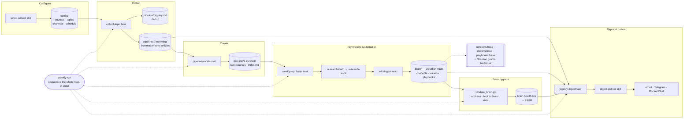

# research-brain

> 🌐 [Краткий старт по-русски](QUICKSTART.ru.md) — полная документация ведётся на английском.
>
> 🚀 **New here? Start with [`FIRST-RUN.md`](FIRST-RUN.md)** — seven steps from an unpacked
> folder to your first digest (Windows is supported natively — `.\install.ps1`).

A distributable, configurable research workflow for people who follow more sources
than they can read carefully. It helps select material worth attention, preserve
source-backed concepts in a local **Obsidian vault**, and find those concepts again when
a question returns. A weekly digest shows what changed and what may need review; it is
one way to use the accumulated knowledge, not the knowledge base itself.

The workflow runs inside **Cowork / Claude Code** or another capable agent runtime.
Its value over time still needs to be established in a real pilot, including the effort
of checking and maintaining the notes.

It is **topic-agnostic** — point it at any subject by editing two config files.

---

## Who it's for

The first supported audience is technical analysts, founders, researchers, and
developers who already use an agent runtime and want a private, inspectable way to keep
up with a fast-moving field, market, or set of sources. The agent does the collecting,
distilling, and summarizing; you read the digest and explore the graph.

### Two capability levels

| Mode | What you get | Status |
|---|---|---|
| **Full agentic research brain** | Ranked multi-source collection, sanitized curation, synthesis into `brain/`, rich digest, and delivery. | **Supported default.** Run `weekly-run.md` through Cowork, Claude Code, Codex, or another capable agent runtime. |
| **RSS Digest Lite** | Full-body RSS collection, sanitization, deterministic digest, and headless delivery. No automatic rich curation/synthesis into the vault; `technical_level` cannot reword deterministic prose. | Reduced fallback for servers where no agent runtime is available. |

The two modes share files, safety checks, and delivery state, but they are not
feature-equivalent. If you want the compounding knowledge base described above, use the
full agentic path.

### Optional: query the vault from project agents

The experimental [local MCP adapter](integrations/mcp_server/README.md) lets another
MCP-compatible agent search the vault index and curated concept text while you work in a
project. It uses bounded lexical ranking over up to 1,000 notes / 32 MiB and returns at most
two compact matches with excerpts and matching fields. It is not semantic search and does
not build a generated index. With
`request_mode=research`, it marks results as context for the existing local-corpus-first
research workflow; the adapter itself does not run research. Saving requires an explicit
user request and the interactive `wiki-ingest` approval gate. The adapter has its own isolated
environment and does not add dependencies to the core runtime. Vault text returned through
MCP may be sent to the connected host's configured model provider.

---

## The 3-step pitch

1. **Configure** — open the folder in Cowork / Claude Code and say *"let's set up
   sources"*. The `setup-wizard` skill interviews you and writes your `config/`.
2. **Let it run** — on a schedule (or on demand) the whole loop runs in order
   (`weekly-run`): collect → sanitize-incoming (the S1–S9 anti-injection gate)
   → `pipeline-curate` → `weekly-synthesis` (auto, into `brain/`)
   → extract lessons/playbooks → brain hygiene (`validate_brain.py`) → build digest → deliver.
   No manual step.
3. **Read the digest** — it lands in your enabled channels (email / Telegram /
   Rocket.Chat) with new sources, real concept definitions, and a one-line brain-health
   summary. The `brain/` vault keeps growing underneath it.

---

## Fastest start

**Recommended full agentic path:** unzip the archive, open the folder in Cowork /
Claude Code, and say **"let's set up sources"**. The setup wizard writes the config,
then ends with an activation checklist (`Source:`, `Config:`, `Delivery:`, `Schedule:`,
`First value:`, `Next action:`) from `scripts/setup_check.py`. Written files alone do not
mean setup is complete; the schedule is only complete after you register one recurring run
for `schedule/weekly-run.md`.

You can also acquire the source with `git clone <repo-url>` or download its ZIP.
Use a separate unpacked copy for personal collection and delivery; contributor checks
belong in the source checkout.

**Advanced no-agent / RSS Digest Lite path:** from inside the folder run:

```bash
./install.sh --configure
```

This bootstraps **uv**, creates `.venv`, seeds `config/.env`, and runs the terminal
configurator for the reduced headless/RSS path. Use it when no agent runtime is available;
the full compounding knowledge loop needs the full agentic path above. (A bare
`./install.sh` — what `make install` runs — installs the dependencies only and configures
nothing.)

Full walkthrough (no terminal required): **[QUICKSTART.md](QUICKSTART.md)**.
What compounds after a month vs an RSS reader — the week-1 → week-4 before/after:
**[docs/WALKTHROUGH.md](docs/WALKTHROUGH.md)**.

---

## Features

- **Weekly digest, the hero feature** — a skimmable summary of new sources, real concept
  definitions, items needing attention, and a one-line brain-health note. It opens with a
  one-line volume summary and a **TL;DR** (busiest topic, standout source, every updated
  concept), groups **new sources** by topic badge (🏷) as a **curated** view — the top
  sources per topic by credibility with a `+N more` note and an optional one-line synthesis
  lead, not every article — shows **updated concepts**
  as cards with a per-concept **publisher-diversity marker** (🔵 / 🟡 — see below), a synthesis
  paragraph, and a "needs attention" backlog. It renders as plain text for Telegram and as a
  **premium styled HTML email**. Source-credibility (`tier`) markers, "quiet week"
  suppression, and idempotent delivery (per-channel receipts + a concurrency lock so
  overlapping runs can't double-send; re-runs skip already-sent channels unless `--force`)
  are built in. Full anatomy in
  [USER_GUIDE.md](USER_GUIDE.md#5-the-digest-anatomy) / [CONVENTIONS §17](docs/CONVENTIONS.md).
- **Digest extras — glossary, daily & trends cadences, operator report** — a plain-language
  **📖 Glossary** section (terms from `config/glossary.yaml`) is appended when a digest uses
  jargon; an optional **daily inflow digest** (`build_digest.py --daily`) adds a second
  cadence; a **weekly trends** section rides every non-quiet weekly digest by default
  (`--no-trends` disables; standalone `scripts/trends.py` or `/trends` on demand); and
  `build_digest.py --report` writes a static browser **operator report** with a per-source
  audit drilldown — its Digest tab doubles as a morning reading list: a cross-topic
  **Read today** top-3 with reading estimates, momentum arrows on topic badges, per-source
  "why am I seeing this" chips, read-progress and ⭐ picks (shareable to Telegram), and a
  link back to the previous issue. See [USER_GUIDE.md §5](USER_GUIDE.md#5-the-digest-anatomy).
- **Publisher-diversity markers** — each concept can show how many publisher domains
  appear in its source records: `🔵 N retained publisher domains — check the claim` or
  `🟡 One retained publisher domain — check the claim`. Optional text deduplication can collapse
  near-identical reprints; it cannot prove independent reporting or that a passage supports
  a claim. The marker is a prompt to inspect the evidence, not a confirmation badge.
  See [CONVENTIONS §16](docs/CONVENTIONS.md).
- **Conversational setup** — no hand-editing YAML; the `setup-wizard` writes the config
  for you. Starter-pack fast path, derives `config/tags.yaml`, asks per-source `tier`,
  writes the full schedule, explains each channel's prerequisites, and verifies activation
  with `scripts/setup_check.py`. It reports whether setup is `complete`,
  `ready_schedule_not_registered`, or `needs_attention` instead of treating config writes
  as success.
- **Audience level (technical ↔ non-technical)** — one knob, `delivery.technical_level`
  (`technical` / `balanced` / `non-technical`, default `balanced`), controls how much the
  digest and answers explain vs assume: a less-technical reader gets more explanation and
  expanded acronyms, a technical one gets terse output with raw specifics. It is **render-time
  only** — `brain/` stays full-fidelity, so switching levels is instant and needs no
  re-processing. Set it in `setup-wizard` or via `/audience`. See
  [docs/audience-levels.md](docs/audience-levels.md).
- **Config-driven, multi-stage collection (RSS-first)** — sources and topics live in
  `config/sources.yaml` and `config/topics.yaml` (a legacy `.md`-config install migrates
  once via `scripts/schema.py migrate-config`);
  collection reads them at runtime, nothing is hardcoded. Per topic it gathers candidates from three source roles — **RSS** feeds, the
  tool's **Official** pages, and **Search** platforms (Medium / dev.to / Habr) — pools
  ~25, ranks them, and reads the best ~10 (both tunable in `config/schedule.yaml`). A cheap→
  costly ladder (RSS → RSS+fetch → static page → browser), canonical-URL dedup (the persistent
  key; GUID is in-run only) plus hybrid near-dup detection (`scripts/dedup.py`), and source
  `tier` carried into the digest.
  See [CONVENTIONS §12](docs/CONVENTIONS.md).
- **Web search / fact-check enrichment (configurable)** — corroboration and research use a
  search provider set in `config/search.yaml`: the default is Claude's built-in
  **WebSearch** (no key), with optional **Tavily** or **Perplexity** by adding an API key
  in `config/.env`.
- **Automatic knowledge loop, with visible maintenance signals** — `pipeline-curate` promotes collected
  articles into the curated stage; `weekly-synthesis` synthesizes curated material into
  `brain/` concepts unattended; `validate_brain.py` runs a hygiene pass each week (orphans,
  broken links, missing sources, stale notes). The vault grows automatically and surfaces
  issues that still need attention, sequenced safely by `weekly-run`.
- **Obsidian knowledge vault** — knowledge lives in `brain/` as linked Markdown notes.
  Concepts link via `related_concept:` frontmatter + tags (controlled `domain/topic`
  vocabulary in `config/tags.yaml`) + Obsidian backlinks; every fact cites a `sources:`
  entry. Authors of cited sources become **backlink-only author nodes** (`brain/authors/`,
  `type: author`) linked from each concept's `contributors:` field. The live front doors
  are **`brain/concepts.base`**, **`brain/lessons.base`**, and **`brain/playbooks.base`**
  (Obsidian Bases, zero gardening; needs Obsidian >=1.7), with `brain/INDEX.md` as the
  plain-markdown fallback.
- **Multi-channel delivery** — email (premium HTML), Telegram, Rocket.Chat. Two transports:
  MCP tools inside Cowork / Claude Code, or a headless Python module for `cron`.
- **Follow authors, not just feeds** — track specific people with `/author add`. Two
  variants are **collected**: `rss` (their own feed) and `publication-filter` (a
  publication you already monitor, narrowed to them); their new work flows into your
  topics. Source Insights also *suggests* people worth following — it never adds them.
  `scholarly` (papers by ORCID/OpenAlex id) can be staged in the roster but is **not
  collected**; `/author add`
  says so. The former `search` author variant is retired: existing entries stay readable
  until removed, while `/discover` proposes sources on demand. Details in [USER_GUIDE](USER_GUIDE.md).
- **Telegram quick commands** — `/new` `/trends` `/know` `/digest` `/send` `/run` `/sources`
  `/discover` `/author` `/add` `/save` `/process` `/research` `/concept` `/audience` (plus the
  bare words `help` and `status`) work as chat shortcuts (MCP/Cowork runtime only, not headless cron). Type `help`
  / `status` **without** the leading slash — the Telegram plugin swallows `/help`, `/status`,
  `/start` before they reach the project. Setup and the BotFather menu are in
  [docs/telegram-commands.md](docs/telegram-commands.md).
- **Health monitoring** — ask **brain-ask** *"is everything ok?"* for a plain-language
  system-health report: feeds alive, delivery succeeded, digest fresh. See
  [CONVENTIONS §18](docs/CONVENTIONS.md).
- **Scheduling** — one `weekly-run` (recommended) via Claude Code cloud agents
  (`/schedule`) or external `cron`; component cron times remain available for split jobs.

---

## The loop



---

## Repository map

| Path | What it holds |
|------|---------------|
| `config/` | All user configuration: `sources.yaml` + `topics.yaml` (the source/topic config — legacy `sources.md`/`topics.md` tables are retired and can be imported once via `migrate-config`), `channels.yaml`, `schedule.yaml`, `tags.yaml` (controlled tag vocabulary), `authors.yaml` (the followed-authors roster, created on first `/author add`), `glossary.yaml`, `search.yaml`, `research.yaml`, `agents.yaml` (the source of truth for the least-privilege pipeline **role agents** — `.claude/agents/*.md` and the Codex profiles are generated from it, see [ADR 0015](docs/adr/0015-least-privilege-role-subagents.md)), the `*.example-starter.md` starter packs, and `.env.example`. |
| `integrations/mcp_server/` | Optional local read-only MCP adapter and its isolated dependency environment. |
| `skills/` | The agent skills (the engine): `setup-wizard`, `source-manage` (conversational topic/source edits), `source-capture` (read-it-later capture → inbox → batched concepts), `intake` (OPML / bare-URL intake), `discover-sources` (proposes new sources for a topic, never adds them), `author-manage` (the followed-authors roster), `brain-ask` (read-only status questions), `brain-review` (content-trust audit of the vault), `concept-manage` (user-facing concept-vault CRUD — create/list/update/archive/restore), the `research-*` chain, `pipeline-curate`, `source-archive`, `wiki-ingest` / `wiki-query`, `digest-build`, `digest-review` (opt-in pre-send gate over a built digest), `digest-deliver`, `digest-feedback` (turns a reader reaction into one reversible tuning change), `whats-new` (quick inline "what's new" answer), `trends` (inline "how is it changing" top movers), `run-now` (whole loop on demand), `capabilities` (what-can-you-do guide). |
| `schedule/` | Scheduled-task definitions: `weekly-run.md` (the recommended single sequential run), `collect-base.md`, `collect-topic.md`, `weekly-curate.md`, `weekly-synthesis.md`, `weekly-digest.md`, `health-watchdog.md` (opt-in health alert, decoupled from the run it reports on), plus the agentic cron wrappers `codex-run.sh` (`codex exec`) and `claude-run.sh` (`claude -p`, for a local install a cloud routine can't reach), sharing one `_agentic-run.sh` preamble. |
| `pipeline/` | The article pipeline: `1-incoming/` → `2-curated/` → `3-synthesis/`, plus `0-archive/` and the dedup `registry.md`. |
| `brain/` | The Obsidian knowledge vault: `concepts/`, `lessons/`, `playbooks/`, `authors/` (backlink-only author nodes, `type: author`), the `concepts.base` / `lessons.base` / `playbooks.base` front-door views, and the `INDEX.md` Map of Content fallback. |
| `scripts/` | Helpers: frontmatter validators, `collect.py` (headless RSS collector facade, with internals in `scripts/collection/`), `manage_sources.py` (source/topic config facade, with internals in `scripts/sources/`), `validate_config.py` (config validator facade, with internals in `scripts/config_validation/`), `extract_vault_notes.py` (additive lesson/playbook extraction), `validate_brain.py` (brain hygiene), `build_digest.py`, `dedup.py` / `normalize_url.py`, `version.py` (version read/compare for updates), + the headless `delivery/` module (`deliver.py` facade, channel/config/quiet/receipt/MCP/health internals, and per-channel adapters). |
| `install.sh` / `update.sh` | One-command setup, and the safe in-place upgrade (overlay code, preserve data, back up first — see [`docs/updating.md`](docs/updating.md)). |
| `templates/` | Copy-me templates (e.g. `article-template.md`). |
| `tests/` | `pytest` suite mirroring `scripts/` *(dev checkout only — excluded from the shipped archive)*. |
| `docs/` | Project docs — see [`docs/architecture.md`](docs/architecture.md), [`docs/scheduling.md`](docs/scheduling.md), [`docs/telegram-commands.md`](docs/telegram-commands.md), the [`CONVENTIONS.md`](docs/CONVENTIONS.md) contract, and architecture decision records in [`docs/adr/`](docs/adr/README.md). |

---

## Get started

**Requirements.** Acquire the project (`git clone <repo-url>`, or download and unpack the
archive) and open the folder in Cowork / Claude Code. You need Python **3.11+** (the repo pins
3.11 via `.python-version`) and [**uv**](https://docs.astral.sh/uv/). One command sets up the dev environment —
it creates `.venv` (pinned by `.python-version`) and installs the runtime + dev deps from
`uv.lock`:

```bash
make setup        # = uv sync
```

The only third-party **runtime** dependency is PyYAML; everything else is the Python stdlib.
No uv? Fall back to pip with the locked runtime export: `pip install -r requirements.txt`
(the test/lint tooling lives in the dev checkout only).

**Platform.** macOS / Linux / Windows. The concurrency primitives are cross-platform —
the registry lock uses `fcntl.flock` on POSIX and `msvcrt.locking` on Windows
(`scripts/registry.py`), and process-liveness uses a non-destructive probe on each. On
Windows run `.\install.ps1` instead of `./install.sh` (or use WSL for a Unix-identical
setup). Headless scheduling uses cron on POSIX and Task Scheduler on Windows — see
[`docs/scheduling.md`](docs/scheduling.md).

- **[QUICKSTART.md](QUICKSTART.md)** — running in a few minutes.
- **[USER_GUIDE.md](USER_GUIDE.md)** — config files, skill catalog, knowledge model,
  delivery channels, scheduling, troubleshooting.
- **[docs/architecture.md](docs/architecture.md)** — how the pieces fit together.
- **[docs/scheduling.md](docs/scheduling.md)** — automating collection and delivery.
- **[docs/PILOT.md](docs/PILOT.md)** — the two-cycle full-product validation and release gate.
- **[docs/updating.md](docs/updating.md)** — upgrading to a new release without losing your data.
- **[docs/SUPPORT.md](docs/SUPPORT.md)** — what's supported vs best-effort, and the upgrade policy.

### Updating to a new release

Your data is never touched by an update. From inside your install, point `update.sh`
at the new archive (a `.zip` or an unpacked folder):

```bash
./update.sh path/to/research-brain-<new>.zip     # --dry-run to preview first
```

It overlays the new code, **preserves** your vault (`brain/`), run data (`pipeline/`),
secrets (`config/.env`) and your customized config (`sources`/`topics`/`channels`/`tags`),
refuses a silent downgrade, and takes a full backup first. Details and rollback:
[`docs/updating.md`](docs/updating.md); the release history is in [`CHANGELOG.md`](CHANGELOG.md).


### Reuse checked project solutions

[Problem-solution records](docs/problem-solutions.md) retain applicability, evidence and
limits for reuse across projects. Validate a candidate, review its exact note/evidence/MOC
package, and save after direct owner approval. The read-only MCP adapter can filter these
records by programming language and problem type. Private candidates and approvals stay
outside searchable concepts and public exports.
