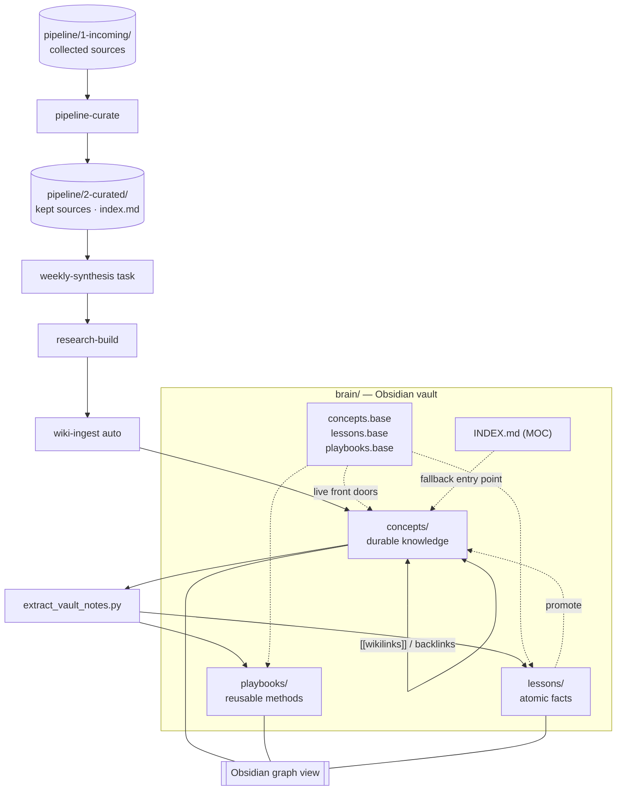

# User guide

A deeper reference for running research-brain. For a fast start, see
[QUICKSTART.md](QUICKSTART.md); for how the pieces fit together, see
[docs/architecture.md](docs/architecture.md).

---

## 1. Configuration files

All configuration lives in `config/`. Run the **`setup-wizard`** skill to fill these
out conversationally, or edit them by hand. The contract for paths, schemas, and
naming is in [docs/CONVENTIONS.md](docs/CONVENTIONS.md).

| File | Format | What it does |
|------|--------|--------------|
| `config/sources.yaml` | YAML | **The** source config — where to collect from, one entry per source (url, type, tier, priority, filter, active). Created by setup or `scripts/schema.py migrate-config`. |
| `config/topics.yaml` | YAML | **The** topics config — the topics you track (name, tags, include/exclude rules). Drives collection **and** digest grouping. |
| `config/sources.md` / `config/topics.md` | markdown | Retired in private development — the runtime no longer reads the legacy `.md` tables; a legacy install imports them once via `python3 scripts/schema.py migrate-config` (the `.md` files stay untouched as rollback). |
| `config/channels.yaml` | YAML (fixed schema) | Digest delivery channels. All disabled by default. |
| `config/schedule.yaml` | YAML (fixed schema) | The cadence for every step: `collect` / `curate` / `synthesis` / `digest` + `timezone` (cron). |
| `config/tags.yaml` | YAML (fixed registry) | The controlled tag vocabulary (`domain → [topics]` + synonyms + pending). Machine-owned — derived by `setup-wizard`; promotions are *recommended* by `validate_brain.py` (advisory) and *applied* by `promote_tags.py`. Do **not** hand-garden. |
| `config/.env.example` | env | Template documenting every secret key. Copy to `config/.env` and fill in. |
| `config/search.yaml` | YAML | Optional web-search provider for fact-check corroboration & headless runs. Default `claude-websearch` (in-agent, no key). Set `provider: tavily` or `perplexity` + key in `.env` to enable. See §15. |
| `config/research.yaml` | YAML | Optional Sonar cross-check (independent second opinion in research-build's Phase 6.5 critique). Key-gated: set `PERPLEXITY_API_KEY` to activate, or `cross_check.provider: none` to disable. |
| `config/glossary.yaml` | YAML | Plain-language `term → explanation` map for the digest's 📖 Glossary section. Edit or extend freely; delete to disable. See §5. |

> **Secrets never live in YAML.** `channels.yaml` references env var *names* only (the
> `*_env` fields); the real values go in `config/.env` (gitignored).

### Keeping names in sync

A topic name is the join key across the system: it is the topic name in the topics
config, the category name in the sources config, the subfolder under
`pipeline/1-incoming/`, and the `category` written into the registry. Keep that one
string identical everywhere (the `manage_sources.py` backend does this automatically).

---

## 2. Adding & editing sources and topics

### The easiest way: just say it

You no longer have to edit any tables to change what's watched. Tell the agent in plain
language and the **`source-manage`** skill makes the change for you (it asks if anything
is missing — it never guesses a topic, type, or URL). For example:

- *"start monitoring AI agents"* — adds a new topic.
- *"watch this blog: https://simonwillison.net/"* — adds a source (it detects the type and
  confirms, and asks which topic and how much you trust it).
- *"add this RSS feed https://hnrss.org/frontpage to tech-news"* — adds a feed.
- *"pause this source: https://hnrss.org/frontpage"* — stops collecting it without deleting it.
- *"stop monitoring topic markets"* — removes a whole topic (it confirms first).

`source-manage` is for **changes** only. To just *ask* what's monitored ("what are we
monitoring?"), see the **Just ask** subsection under §3 — that's a different skill.

The method below is the **by-hand** alternative, for when you'd rather edit the files
directly. Prefer the `manage_sources.py` CLI (next section) — it edits the YAML config
and keeps everything in sync.

### Add a topic + source by hand (active YAML config)

In `config/topics.yaml`, add one entry per topic, and mirror it as a category in
`config/sources.yaml` (same name):

```yaml
# config/topics.yaml
topics:
  - name: markets
    tags: [markets, finance]
    include: "Substantive analysis of the markets you track."
    exclude: "Pure price tickers, off-topic promos."
```

```yaml
# config/sources.yaml
categories:
  - name: markets
    sources:
      - url: "https://example.com/feed.xml"
        type: rss
        tier: high        # source credibility: high | medium | low
        priority: high    # collection ordering: high | medium | low
        filter: "all articles"
        active: true
```

(On a legacy install that still has only the retired `config/sources.md` /
`config/topics.md` tables, nothing runs until you import them once with
`python3 scripts/schema.py migrate-config` — it writes the YAML twins and leaves the
`.md` files untouched as the rollback copy.)

`tier` is the source's **credibility** (`high` / `medium` / `low`) — copied onto each
collected article and shown next to the item in the digest. It is independent of
`priority` (which only orders collection). A starter pack with ready-to-use feeds
ships in `config/sources.example-starter.md`.

**Source types** (the `type` field):

| Type | How it's fetched | Use when |
|------|------------------|----------|
| `rss` | WebFetch + XML parse | A feed exists — **preferred**, most reliable. |
| `blog` | Navigate the index page, prefer its feed, else scrape links | A blog index without an obvious feed. |
| `medium-tag` | Browser navigation + JS extraction of a `/tag/<x>/latest` page | Medium tag pages. |
| `webpage` | Navigate a single page and scrape links | Any page with no feed (fallback). |

Set `active: false` to park a source without deleting it. The collect task reads only
active sources.

> **How collection uses these.** Each run gathers candidates per topic from three source
> roles in parallel — your **RSS** feeds, the tool's **Official** news/docs/blog pages, and
> **Search** platforms (Medium / dev.to / Habr — Habr is RU) — pools roughly 25 candidates, ranks them by
> relevance × freshness × `tier`, then fully reads only the best ~10 (gather wide → rank →
> read best). Both numbers live in `config/schedule.yaml`
> (`candidate_pool_per_topic` / `max_articles_per_topic`). See
> [docs/CONVENTIONS.md](docs/CONVENTIONS.md) §12.

> The `setup-wizard` does all of the above interactively, including validating each URL
> and detecting its type — editing by hand is the manual alternative.

### The scriptable way: `manage_sources.py` (no agent)

For a headless box, a script, or any agent without the Skill tool (Codex / Copilot /
cron), `scripts/manage_sources.py` is the deterministic CLI the `source-manage` skill calls
under the hood. Every mutation writes the YAML config (`config/topics.yaml` +
`config/sources.yaml`), keeps topic and category names in sync, is idempotent, and
re-validates the config afterwards.

| Command | What it does |
|---------|--------------|
| `list` | Show monitored topics and their sources. |
| `add-topic <name>` | Add a monitored topic (creates the topic + matching source category). |
| `add-source <topic> <url> --type rss --tier high [--priority …] [--filter …]` | Add a source row to a topic. |
| `pause <url>` / `resume <url>` | Flip a source's `Active` flag without deleting it. |
| `remove-source <url>` | Delete one source row by URL. |
| `remove-topic <name>` | Remove a topic and its category block. |

```bash
# Examples (run from the project root):
uv run python scripts/manage_sources.py list
uv run python scripts/manage_sources.py add-topic markets
uv run python scripts/manage_sources.py add-source markets https://example.com/feed.xml --type rss --tier high
uv run python scripts/manage_sources.py pause https://example.com/feed.xml
```

For a **guided first-time** setup without an agent, `scripts/configure.py` runs the same
questions interactively (topics → sources → channels → schedule → language → audience level) and writes the
whole `config/` for you — the no-agent counterpart to the `setup-wizard` skill. Run it with
`make configure` (or `uv run python scripts/configure.py`).

### Follow an author (people, not feeds)

Sometimes you want a *person*, not a site. `/author add` (skill: `author-manage`,
CLI: `scripts/manage_authors.py`) adds someone to a followed-authors roster
(`config/authors.yaml`). There are three new `--monitoring` choices, and **two are
collected today**:

| variant | use when | collected? |
|---|---|---|
| `rss` | they publish their own feed (`--feed URL`) | **yes** — taken as an ordinary source under their `--topic` |
| `publication-filter` | they write for a publication you already monitor (`--publication HOST` + `--id`/`--url`) | **yes** — that feed, filtered to just their items |
| `scholarly` | they publish papers (`--id orcid:… \| openalex:…`) | **not yet** — staged in the roster only |

When you add a `scholarly` author, the CLI tells you plainly that they are
staged but nothing is fetched: scholarly ingestion is not implemented. The retired
`search` author variant is no longer available for new entries. Existing `search`
rows remain readable and removable, and `/discover` proposes sources on demand.
Manage the roster with `/author list`, `/author pause|resume|remove <name>`, and see which vault author
nodes are followed with `/author nodes` (read-only).

Following a person is different from **Source Insights**, which only *suggests* authors
worth following from who recurs in your collected articles — it never adds anyone. And
`/author` is for people; a feed or site goes through `source-manage` / `/add`.

---

## 3. Skill catalog

The skills live in `skills/{name}/SKILL.md`. The agent picks one up when your message
matches its trigger phrases. The research skills form an ordered chain.

| Skill | When to use | Trigger phrases |
|-------|-------------|-----------------|
| **`setup-wizard`** | First-run setup, or reconfigure one part of the config. | "set up sources", "configure", "let's set up", "first-time setup", "onboarding" |
| **`intake`** | **Just send a link** — the primary way to add anything. It classifies the URL: a feed → monitored (via `source-manage`), a one-off article → the inbox (via `source-capture`), ambiguous → one question. Also imports OPML subscriptions. `/add` and `/save` are expert shortcuts that skip the classification. | just paste a URL, "add this", "add this link", "вот ссылка", "добавь это", "import my OPML subscriptions" |
| **`source-manage`** | One quick **change** to what's monitored — add/pause/remove a topic or source — said in plain language. It asks for anything missing; never invents. (A bare link belongs to `intake`; `/add <url>` is the expert shortcut straight here.) | "start monitoring X", "watch this blog", "add this RSS feed", "pause this source", "stop monitoring topic Z", "remove this source" |
| **`source-capture`** | Capture a **single** read-it-later article (a link) into the inbox, then turn the accumulated queue into concepts in batches (instant capture, batched processing — on threshold, `/process`, or the weekly run). Different from `source-manage` (recurring feed). (A bare link belongs to `intake`; `/save <url>` is the expert shortcut straight here.) | "save this article: <url>", "read this and keep it", "process the inbox", "сохрани эту статью", "разбери накопленное" |
| **`discover-sources`** | **"Who else should I be reading about X?"** — searches, groups the results by site, drops what you already monitor, and proposes at most ten, each with the reason it surfaced. Strictly read-only: it **never** adds a source; you pick, and `source-manage` writes it (and sets the trust tier). | "/discover <topic>", "find new sources for X", "who should I read about X", "find alternatives to my sources", "найди новые источники по X" |
| **`author-manage`** | Manage the **followed-authors roster** (`config/authors.yaml`) — follow a person you've decided to read, list the roster, list the author *nodes* your vault knows (`followed: yes/no`), pause/resume, or remove. One intent per turn. Different from `source-manage` (a feed, not a person); see §2 "Follow an author". | "follow this author", "/author add", "list authors", "who am I following", "/author nodes", "pause author X", "unfollow X", "подписаться на автора", "кого я читаю" |
| **`brain-ask`** | A **read-only question** about our own state — what we monitor, how often, recent digests, this week's findings. Never changes anything. | "what are we monitoring?", "how often do we collect?", "show the last digest", "top 5 digests", "key findings this week" |
| **`brain-review`** | A **deep accuracy audit** of the knowledge base — re-checks stored concepts against their own cited sources for hallucinations, single-source claims and staleness. Heavier than `brain-ask` (which only reports status); it proposes fixes, never edits silently. Best run occasionally (e.g. monthly). | "audit the knowledge base", "is the vault accurate", "re-verify the concepts", "check the brain for hallucinations", "проверь базу знаний", "аудит достоверности" |
| **`concept-manage`** | User-facing concept-vault CRUD — create a monitored concept via interview, list, update (re-research), archive/restore (soft-delete). One intent per turn. `/concept new\|list\|update\|archive\|restore` | "new concept", "create a concept", "track this as a concept", "list concepts", "update concept X", "archive concept X", "restore concept X" |
| **`whats-new`** | The everyday **"what's new?"** — quick fresh collect + an inline answer right in the chat. No digest file, nothing sent; the formal builds stay in `digest-build`/`run-now`. | "what's new?", "anything new?", "что нового", "/new" |
| **`trends`** | **"How is it changing?"** — inline top movers (topic volume vs last week, rising tags, activity, knowledge growth) from data already on disk. Read-only; persists no report. The weekly digest embeds the same section by default. | "/trends", "what's trending?", "how are my topics changing?", "тренды", "что растёт" |
| **`digest-build`** | **Build** a digest on demand, right now (writes the file locally; does **not** send — hands off to `digest-deliver`). | "build a digest now", "build the weekly digest", "make a digest" |
| **`run-now`** | Run the **whole cycle** on demand, right now — collect → sanitize-incoming → curate → synthesis → extract lessons/playbooks → hygiene → build digest → deliver, in order (the same steps as the scheduled weekly run). Wider than `digest-build` (build only) or `digest-deliver` (send only). | "run the pipeline now", "do a full run", "collect and send me a digest now", "прогони цикл сейчас", "собери всё сейчас" |
| **`research-frame`** | **First** on any research-intent query — frames the work and routes it. | "research X", "investigate", "deep dive", "topic overview", "what do we know about X" |
| **`wiki-query`** | After `research-frame`, or directly for “what does my brain know about X?” — reads only the existing vault. A direct vault-query miss offers deeper research but does not start it silently. | "/know <topic>", "what does my brain know about X?", "что моя база знает о X", "search the vault", "concepts on topic=X" |
| **`research-grep`** | After `wiki-query` misses — greps the local corpus before any web fetch. | "look into", "gather material", "what do we have on", "inventory the topic" |
| **`research-build`** | Compile multi-source material into a structured Markdown document. Never the first responder. | "synthesize from the brief", "build a research document from these materials" |
| **`research-audit`** | Verify a draft's claims against source tier & recency (🟢/🟡/🔴). | "check facts", "verify claims", "is this ready to ship?", "check the sources" |
| **`pipeline-curate`** | Promote collected articles from `pipeline/1-incoming/` into the curated stage — the link between collection and synthesis. | "curate", "curate pipeline", "promote incoming", "курируй" |
| **`source-archive`** | Persist a fetched web source into the archive zone (auto-hooks on web fetches). | "archive this URL", "save this source", "persist to the archive" |
| **`wiki-ingest`** | After `research-build` — propose updates to `brain/concepts/`. Post-task only. | "update the vault", "sync brain", "ingest into concepts", "add this fact to a concept" |
| **`digest-review`** | **Opt-in adversarial pre-send gate** over a built digest — checks its claims are grounded in the cited sources, the trust markers are earned, no injection leaked into the delivered text, and every cited link resolves. Runs between the `digest-deliver` rehearsal and the real send, only when `delivery.pre_send_review: true`; advisory by design (surfaces findings, never silently blocks the unattended digest). | "review the digest before sending", "pre-send check", "is the digest safe to send", "vet the digest" |
| **`digest-deliver`** | Send a built digest to enabled channels. | "deliver digest", "send digest", "send the weekly digest", "push the digest" |
| **`digest-feedback`** | React to a delivered digest in plain words — one reversible tuning change (audience-level step, or topic/source pause with confirm-first) + every reaction recorded. See [docs/feedback.md](docs/feedback.md). | "too technical", "simpler", "more technical", "less of X", "mute X", "not useful", 👍/👎, «слишком технично», «попроще», «поменьше X» |
| **`capabilities`** | A friendly **what-can-you-do** menu — orientation only, it changes nothing and runs nothing. | "what can you do?", "help" |

> Collection itself is a **scheduled task** (`schedule/collect-topic.md`), not a skill —
> you trigger it by asking the agent to "collect my topics" or let the schedule run it.

### Just ask

You don't have to dig through config files to see what the system is doing. Ask in plain
language and **`brain-ask`** answers from the project's own state (read-only — it changes
nothing):

- *"what are we monitoring?"*
- *"how often do we collect?"*
- *"show me the last digest"* / *"show the last 5 digests"*
- *"key findings this week"*
- *"is everything ok?"* / *"is the system healthy?"* — a plain-language **health** report
  (see below).

#### Health check — "is everything ok?"

`brain-ask` has a dedicated **health** intent for operational status — the "is the plumbing
working?" question, separate from knowledge quality (that's brain hygiene, §4). Ask *"is
everything ok?"*, *"are the feeds alive?"*, or *"did the last digest go out?"* and it reports,
in plain language:

- **Feed liveness** — whether each source is still returning items (a feed that comes back
  empty for the last couple of runs is flagged as likely dead).
- **Delivery** — the latest send status per channel (a failed send is surfaced, not hidden).
- **Digest freshness** — how recent the last digest is (stale once it's more than ~8 days old).
- **Vault health** — the one-line brain-hygiene headline.

The verdict is *"everything's ok"* only when there are no dead feeds, no failed deliveries,
and the digest isn't stale. It reads an append-only run log (`pipeline/.health/events.jsonl`,
gitignored) written by collection, delivery, and the weekly run; details are in
[docs/CONVENTIONS.md](docs/CONVENTIONS.md) §18.

> **Which skill?** *Asking* about state → `brain-ask`. *Changing* a source or topic →
> `source-manage`. *Building* a digest now → `digest-build`. *Sending* a built digest →
> `digest-deliver`. *Running the whole cycle now* → `run-now`. *Not sure what you can do /
> help* → `capabilities`.

---

## 4. The knowledge model

Knowledge accumulates in **`brain/`**, which **is** an Obsidian vault. Three note types:

| Folder | Holds | Lifespan |
|--------|-------|----------|
| `concepts/` | Durable distilled knowledge — synthesized answers to recurring questions, one topic per note. | Long-lived, updated over time. |
| `lessons/` | Atomic facts / watchlist items — small single-fact extracts not yet a full concept. | Promoted into a concept, or kept as a standing fact. |
| `playbooks/` | Reusable methods — step-by-step procedures you re-run. | Long-lived, refined as you learn. |

**How concepts connect.** The primary link is the **`related_concept:`** frontmatter key
(a machine-checkable list of `[[concepts/other-note]]` targets) — that, plus **shared
tags**, is what builds the graph. Obsidian **backlinks** and inline `[[wikilinks]]` are a
secondary, in-body layer. Each concept also carries a structured **`sources:`** block:
every key fact cites a source (url + archive path + date + `tier`), so the vault stays
verifiable rather than hallucinated.

**The front doors.** Open **`brain/concepts.base`**, **`brain/lessons.base`**, or
**`brain/playbooks.base`** in **Obsidian >=1.7**. They are live, auto-updating Bases views:
concepts have an **All concepts** table and **By domain** cards, lessons group by
confidence, and playbooks group by review status. On older Obsidian or outside it, the
plain-markdown fallback is **`brain/INDEX.md`**, a hand-curated **Map of Content** (MOC) —
the human entry point and the first file `wiki-query` reads. Navigation model: Bases + the
MOC are the front door; **tags are a secondary filter**; the **graph view is a demo** of
connections, not how you navigate.

**How lessons and playbooks appear.** Weekly synthesis writes durable concepts first. Then
`scripts/extract_vault_notes.py` looks for explicit sections inside those concepts:
`## Lessons` / `## Key lessons` bullets become atomic lesson notes, and
`## Playbook: <name>` sections with steps become draft playbooks. The extractor is conservative:
it only uses these named sections, writes missing notes, and never rewrites or deletes existing
vault knowledge. The next digest and the Obsidian Bases front doors pick up the new files
automatically.



`wiki-query` reads the vault (MOC → relevant notes → backlinks); `wiki-ingest` writes to
it (with a source link + provenance tag and an approval gate per write — auto-applied,
no gate, on the unattended `weekly-synthesis` path).

### Tags — a controlled, self-growing vocabulary

Tags are **non-technical and automatic** — you never hand-manage them.

- **Format:** nested `domain/topic` (`ai/agents`, `ai/rag`), in the concept's frontmatter
  `tags:` only (no inline `#tag`). A bare `domain` (`ai`) is a valid tag that natively
  groups all its `ai/*` children — there is **no separate "super-tag" feature**.
- **Registry:** `config/tags.yaml` is the single source of allowed tags (`domains:` map +
  `synonyms:` aliases + a `pending:` quarantine). `wiki-ingest` picks tags **only** from
  it (closed-book); RSS `<category>` values normalize through the same synonym map.
- **Cap/floor:** 2–5 tags per note, **≥1 domain-level tag**.
- **Auto-grow:** when nothing fits, the system proposes **≤1** new `domain/topic` into
  `pending:` (not straight into the vocabulary); `validate_brain.py` (advisory)
  *recommends* promoting a pending tag into `domains:` once it recurs across ≥3 notes
  and normalizes / merges synonyms on every run, while `scripts/promote_tags.py`
  *applies* the promotion in the weekly brain-hygiene step (and `source-manage` seeds a
  new topic's tag on add-topic).

`setup-wizard` derives the initial `tags.yaml` from your topic names; from then on it
grows itself.

### Brain hygiene — kept healthy for you

A vault for non-technical users must stay healthy without manual gardening, so
`scripts/validate_brain.py` runs one **advisory** pass (it never edits or deletes notes)
each week — part of `weekly-run`, after synthesis. It flags orphan concepts (no graph
links), orphan lessons/playbooks (no concept, parent playbook, source concept, or body
wikilink), broken `[[concepts/...]]` links, concepts missing `sources:`, uncited key facts,
tag-hygiene issues (normalization / synonym merges / pending-promotion), and stale notes
(`last_verified + ttl_days` in the past). It writes
`pipeline/3-synthesis/brain-health_YYYY-MM-DD.md`, whose one-line headline
(`brain health: N concepts, X orphans, Y broken links, Z missing-sources, W uncited-facts, V stale`) the
digest surfaces so you see vault health alongside the week's content.

---

## 5. The digest anatomy

The digest is the product you actually read each week. A deterministic builder
(`scripts/build_digest.py`) assembles one Markdown document, then renders it two ways:
a clean plain-text version for Telegram and a **premium styled HTML** version for email
(centered card, accent header, topic-badge pills, styled blockquotes, dark-mode hint). The
sections, in order:

| Section | What it shows |
|---------|---------------|
| **Volume summary** (header) | One line: *"N new sources across M topics, K updated concepts"* — the week at a glance. |
| **TL;DR** | Up to three highlights: 📰 the busiest topic (with its share), 🔎 one standout source (highest `tier` / first listed), and 💡 **every** updated concept (the full list, not "…and N more"). |
| **Knowledge base health** | One line from the latest brain-hygiene pass: 🟢 when the vault has no orphans / broken links / missing sources / stale notes, otherwise ⚠️. |
| **Vault front doors** | The Lessons/Playbooks front-door block: the newest lessons and playbooks (up to 3 each, newest first, then a `+N more` note), pointing at the full `brain/lessons.base` / `brain/playbooks.base` views. |
| **New sources** | Grouped by topic badge `🏷 {topic} (N)`, where `N` is the count of **unique** sources (re-collected duplicates are merged). It's a **curated** view, not a dump: the top **3** sources per topic by credibility (high→low) as cards — bold clickable title, `⭐` for high-`tier`, a one-line takeaway — then a `+N more` note; the full set stays in `pipeline/1-incoming/`. When the weekly run wrote one, a **one-line synthesis lead** sits in italics under the topic badge. |
| **Updated concepts** | One card per concept: bold name, `⭐` for high-`tier`, a **trust marker** line (see below) plus a source link, and the concept's definition in a blockquote. |
| **Synthesis this week** | The opening paragraph of the most recent synthesis run, when one exists. |
| **Needs attention** | Backlog of stale incoming items (collected but not yet curated) — what to look at next. |

A **quiet week** — zero new sources, zero updated concepts, and an empty backlog — collapses
to a short digest (the quiet-week line plus the standing sections, like the vault front
doors), and the headless builder can skip delivery entirely
(`deliver.py --skip-quiet`).

### Plain-language glossary

If a digest uses jargon or acronyms, a **📖 Glossary** section is appended at the end,
explaining — in plain language — **only the terms that actually appear** in that digest.
The terms come from `config/glossary.yaml` (a simple `term → explanation` map you can edit,
extend, or delete to turn off); it ships with a starter set across AI/ML, software, and
marketing. A jargon-free digest gets no glossary. Pair it with a `non-technical` audience
level (see [docs/audience-levels.md](docs/audience-levels.md)) for the most explanatory read.

### An operator report, HTML email, and an optional daily digest

- **Operator report.** For local review, `python3 scripts/build_digest.py --report` writes
  `digest_<date>.report.html` next to the Markdown. It is a static browser page with five
  tabs: **Digest**, **Pulse** — the week in numbers (collection stats, topic bars, trends
  deltas, plus the full per-topic source-audit drilldown folded closed at the bottom),
  **Vault** for lessons/playbooks, **Glossary**, and **Concepts**; the audit sidecar stays
  linked from Pulse. The Digest tab reads like a morning briefing: a **🎯 Read today** strip picks
  the top-3 sources across all topics (by source tier, then rank) with an **≈ minutes** reading
  estimate; topic badges carry **↑/↓ momentum arrows** from the embedded trends data; every
  shown source explains itself with a small **tier · reason** chip; and the hero links **← the
  previous digest**. Two conveniences live in your browser only (localStorage, per digest):
  opened links dim with an **"N of M read"** counter, and a **⭐ star** on any source collects
  picks into a floating bar that shares the list to Telegram (`t.me/share` — paste into your
  bot chat and `intake` captures the links) or copies it. No JS → the page degrades to a plain
  static report.
- **Email HTML.** `python3 scripts/build_digest.py --html` writes `digest_<date>.html`, the
  email-grade HTML render used by the email transport.
- **Audit sidecar.** Every build also writes `digest_<date>.audit.json` next to the Markdown.
  Normal readers can ignore it; it is there for operators and tests when you need to inspect
  selection reasons and the vault-snapshot counts for lessons/playbooks.
- **Daily "inflow" digest (optional).** A lighter, once-a-day digest — just *New sources* +
  *Needs attention*, no synthesis — via `build_digest.py --daily` (→ `digest_daily_<date>.md`).
  Enable its cadence with the `daily_digest` block in `config/schedule.yaml`. See
  [docs/scheduling.md](docs/scheduling.md) and ADR 0016. (Both commands sit behind the
  fail-closed sanitize gate — after a raw headless collect, run
  `python3 scripts/sanitize_incoming.py sanitize` first.)
- **Weekly trends section (on by default).** An extended "how is this changing?" view —
  topic volume this week vs last, rising tags, activity, and knowledge growth, including
  a **created-per-week sparkline** (last 8 weeks, e.g. `▁▂▃▅▇▆▅▃`) that shows the vault
  compounding over time.
  `build_digest.py` embeds it inline in every non-quiet weekly digest (pass `--no-trends`
  to disable). Ask for it on demand with `/trends` (inline answer in the chat), or run it
  standalone via `python3 scripts/trends.py` (→ `trends_<date>.md`) and enable its cadence
  with the `weekly_trends` block in `config/schedule.yaml`. See ADR 0017.

### Publisher-diversity markers

The digest derives a coverage signal from each concept's `sources:` block. It counts
publisher domains, using a small domain-suffix approximation and per-subdomain identities
on selected hosting platforms. The normal builder uses URLs only. An optional text map
can collapse lexical near-duplicates, but neither route proves editorial independence or
checks whether a passage supports a claim.

- **🔵 N retained publisher domains — check the claim** — at least two retained publisher groups.
- **🟡 One retained publisher domain — check the claim** — one retained group, possibly many URLs.
- *(nothing)* — no usable source URLs; no marker is shown.

Several different texts may repeat the same upstream announcement. A factual audit must
inspect the supporting passages and their provenance separately before claiming independent
confirmation. The helper's historical `independent` field is a publisher-count proxy,
not that audit verdict. The exact wording comes from `scripts/corroborate.py`; see
[docs/CONVENTIONS.md](docs/CONVENTIONS.md) §16–§17.

### Research augmentation & fact-check (optional)

Two **opt-in** features sharpen the fact-check and research paths. Both are off-by-default
in the sense that they need no setup to keep working as documented — the defaults already
do the right thing — and you only touch them when you want an external provider in the loop.

**A. Web search providers** (`config/search.yaml`). Out of the box, web search runs through
Claude's built-in WebSearch **in-agent** — nothing to install, no key. To power **headless
runs** (cron, no agent) and the fact-check **corroboration** step with an external provider,
set `search.provider:` to one of:

- `claude-websearch` (default) — the in-agent path; needs nothing.
- `tavily` — needs `TAVILY_API_KEY` in `config/.env`.
- `perplexity` — needs `PERPLEXITY_API_KEY`; uses the raw `/search` results endpoint.
- `none` — disables external search entirely.

Test it from the CLI: `python3 scripts/search/search.py "<query>"`.

**B. Sonar cross-check** (`config/research.yaml`). An **optional independent second
opinion** in research. When `PERPLEXITY_API_KEY` is set, `research-build`'s **Phase 6.5
Critique** asks Perplexity Sonar the same research question and uses its synthesized answer
plus citations as an **adversarial check only** — to surface coverage gaps, missed sources,
or contradictions in the draft. It is **never** copied into the document, and its sources are
never cited second-hand: any source it surfaces is re-fetched through the normal
archive → verify path before it can be cited. So the research pipeline and its trust model
are unchanged whether the cross-check runs or not — it can only *add* scrutiny, never relax
it. Disable it with `cross_check.provider: none`. The default model is `sonar` (the cheapest;
reasoning models cost roughly 8× more and buy nothing here). Test it from the CLI:
`python3 scripts/search/cross_check.py "<question>"`.

> **One key, two slots.** `PERPLEXITY_API_KEY` powers **two independent** opt-in features —
> search corroboration (the raw `/search` endpoint) and the Sonar cross-check (the `/chat`
> endpoint). Setting the key can enable **both**; you control each separately via
> `search.yaml` (provider `perplexity`) and `research.yaml` (`cross_check.provider`)
> respectively.

---

## 6. Delivery channels

### Verified setup result

First-run setup should end with the shared activation checker, not just written config
files:

```bash
python3 scripts/setup_check.py
```

It sends nothing and reports these exact checklist fields: `Source:`, `Config:`,
`Delivery:`, `Schedule:`, `First value:`, and `Next action:`.

Final statuses:

- `complete` — source, config, delivery, and scheduler registration are all verified.
- `ready_schedule_not_registered` — source, config, and delivery are ready, but the user
  still needs to register one recurring run for `schedule/weekly-run.md`. Do it in one
  command: `python3 scripts/install_schedule.py --path claude --apply` (see
  [docs/scheduling.md](docs/scheduling.md) "Registering it in one command").
- `needs_attention` — one or more gates failed.

Common failure categories are `config_error`, `missing_secret`, `unsupported_runtime`, and
`transient_failure`. The recommended **full agentic** setup uses MCP-capable delivery
inside Cowork / Claude Code. **RSS Digest Lite** is the advanced/no-agent fallback; run
`python3 scripts/setup_check.py --runtime headless` for that path.

Three channels are supported — email, Telegram, Rocket.Chat — each configured in
`config/channels.yaml`. All are `enabled: false` by default. There are **two transports**:

- **MCP mode** (default, inside Cowork / Claude Code) — the `digest-deliver` skill calls
  MCP tools directly (Telegram MCP, Gmail MCP). Rocket.Chat always uses its webhook.
- **Headless mode** (cron / no agent) — `scripts/delivery/deliver.py` reads the same
  config and calls the per-channel Python adapters (`email_smtp`, `telegram_botapi`,
  `rocketchat_webhook`). No MCP needed.

`digest-deliver` chooses the transport per channel from the `provider` / `transport` key.

| Channel | Config keys | MCP mode | Headless mode | Secret (in `config/.env`) |
|---------|-------------|----------|---------------|---------------------------|
| email | `provider: gmail-mcp \| smtp`, `to: [...]`, `smtp.{host,port,user}` | `gmail-mcp` → Gmail MCP | `smtp` → `email_smtp.py` | `SMTP_PASSWORD` (smtp only) |
| telegram | `transport: mcp \| bot-api`, `chat_id` | `mcp` → Telegram MCP | `bot-api` → `telegram_botapi.py` | `TELEGRAM_BOT_TOKEN` (bot-api only) |
| rocketchat | `webhook_url_env` | webhook (curl/WebFetch) | `rocketchat_webhook.py` | `ROCKETCHAT_WEBHOOK_URL` (always) |

The digest language is set once via `delivery.language` in the same file (default `en`).

### Prerequisites: channels & credentials

A channel only delivers once its transport is wired up and its credential is available.

**MCP mode (default).** Email and Telegram use MCP connections, so the matching MCP
server must be **connected and authenticated in your Cowork / Claude Code session first**
— Gmail MCP for email (`provider: gmail-mcp`), Telegram MCP for Telegram
(`transport: mcp`). Neither needs a secret in `config/.env`. Rocket.Chat always uses an
incoming webhook (so it always needs `ROCKETCHAT_WEBHOOK_URL`).

**Headless mode (cron / no agent).** The Python adapters need a secret per channel:
`SMTP_PASSWORD` for email (`provider: smtp`), `TELEGRAM_BOT_TOKEN` for Telegram
(`transport: bot-api`), `ROCKETCHAT_WEBHOOK_URL` for Rocket.Chat.

**Obtaining each credential:**

- **Telegram `chat_id`** — message your bot once, then read your id from
  `https://api.telegram.org/bot<TOKEN>/getUpdates` (the `chat.id` field), or message
  **@userinfobot** which replies with your id. It goes in `channels.yaml`
  (`telegram.chat_id`) and is **not** a secret.
- **Email app password** (headless SMTP only) — generate a provider-specific **app
  password** (not your account password) in your account security settings; store it in
  `config/.env` as `SMTP_PASSWORD`. The in-agent email transport needs no password.
- **Rocket.Chat incoming webhook** — **Admin → Integrations → New Incoming Webhook**,
  enable it, choose the target channel, save, and **copy the webhook URL**; store it in
  `config/.env` as `ROCKETCHAT_WEBHOOK_URL`.

**Where headless secrets go:** `config/.env` (copy from `config/.env.example`), never the
YAML — `channels.yaml` references only the env-var *name*. Verify before the first real
send with `python3 scripts/setup_check.py` or, for a specific built digest,
`python3 scripts/delivery/deliver.py <digest> --dry-run`; both report SET / MISSING
without printing secret values.

### Enabling a channel

1. Set `enabled: true` and fill the non-secret params (recipients, chat id, etc.).
2. Choose the transport (`provider` for email, `transport` for telegram).
3. Put the matching secret in `config/.env` (copy from `config/.env.example`).

`digest-deliver` reports a per-channel status line (`SENT` / `SKIPPED` / `FAILED`) and
surfaces a missing secret as an actionable error naming the env var — never a silent skip.

### Telegram quick commands

When the Telegram channel runs in MCP mode (inside Cowork / Claude Code), the agent
recognizes a set of slash commands as chat shortcuts, so you can drive the whole system from
your phone without typing full sentences. Each one just routes to an existing skill — there
is no extra code behind them:

| Command | Does |
|---------|------|
| `/new` | What's new? Quick fresh check, answered right in the chat (no digest file, nothing sent). |
| `/trends` | How is it changing? Inline top movers — topic volume vs last week, rising tags, activity, knowledge growth — from data already on disk. |
| `/know <topic>` | What does my brain know about X? Answered from the existing vault only; a miss offers research instead of starting it silently. |
| `/digest` | Build this week's digest (no send). |
| `/send` | Send the most recently built digest to your enabled channels. |
| `/run` | Run the full loop now: collect → sanitize-incoming → curate → synthesis → extract lessons/playbooks → hygiene → digest → deliver. |
| `status` | System health (feeds, delivery, freshness) + what's monitored + recent digests. |
| `/sources` | List the monitored topics and sources. |
| `/discover <topic>` | Propose NEW sources worth monitoring for a topic (≤10, each with the reason it surfaced). Read-only — it never adds one; you pick, `source-manage` writes it. |
| `/author <sub>` | Manage the followed-authors roster: `add`, `list`, `nodes` (author nodes in the vault, `followed: yes/no`), `pause <name>`, `resume <name>`, `remove <name>`. Bare `/author` lists. |
| `/add <url>` | Start monitoring a source/feed/topic. |
| `/save <url>` | Capture a one-off article (read-it-later) into the inbox queue. |
| `/process` | Turn the captured-article queue into concepts (fan-out → route → synthesis). |
| `/research <q>` | Enter the research chain on a question. |
| `/concept <sub>` | Manage one concept: `new` (interview → monitored concept + note), `list`, `update <name>` (re-research), `archive <name>` (soft-delete), `restore <name>`. Bare `/concept` lists. |
| `/audience <level>` | Set `delivery.technical_level` (`technical` \| `balanced` \| `non-technical`) — how much output is explained vs assumed. |
| `help` | Plain-language menu of what the bot can do. |

> **`/help`, `/status`, `/start` are plugin-intercepted** — the official Telegram plugin
> swallows those three slashes before they reach the project, so they're listed above as
> the **bare words** `help` / `status` (drop the leading slash, or just ask in plain
> language); the routing is identical. All other commands work with the slash.

Arguments after a command are passed through (`/add https://blog.example.com/feed`,
`/research RAG eval`). To make the commands appear in Telegram's `/` menu, register them
once with **@BotFather** — the exact block and steps are in
[docs/telegram-commands.md](docs/telegram-commands.md). **Note:** incoming commands only work
in the MCP / Cowork runtime; a headless cron deployment can still *deliver* to Telegram but
cannot *receive* commands.

---

## 7. Scheduling overview

### Two capability levels, four ways to trigger them

The **full agentic product** runs the gated `weekly-run` and grows the knowledge vault.
The **RSS Digest Lite** fallback runs deterministic collection/build/delivery scripts but
does not independently perform the LLM curation and synthesis that populate `brain/`.
Within those two capability levels, what differs is **who pulls the trigger** and
**whether your machine/session has to be on**. Agent paths can use authorized MCP
connectors; the headless OS-cron path keeps its delivery secrets in `config/.env`.

| Mode | How you start it | Runs while you're away? | Keys in `.env`? | Use it when |
|---|---|---|---|---|
| **Cowork (interactive)** | Open the folder in Cowork and just ask — "set up sources", "run the pipeline now". Setup, on-demand runs, **and** registering the schedule all happen here. | No — you're driving | None | First-time setup; hands-on use; configuring everything (incl. the scheduler) |
| **Claude Code `/schedule` (cloud routine)** | In Claude Code run `/schedule`, point the task at `schedule/weekly-run.md`, give it the cron → it becomes a recurring **cloud** agent. | **Yes** — runs on Anthropic's cloud; fires with your laptop off and Claude Code closed | None\* | You want it unattended on a cadence — "set and forget" |
| **Manual on-demand (agent)** | Inside Cowork or Claude Code: "run the pipeline now" (`run-now`), or "build / send the digest" (`digest-build` / `digest-deliver`). Includes **Telegram** commands (`/run`, `/digest`, `/send`, …) when the bot is configured. | No — you trigger each time | None | A one-off run right now; triggering from your phone via Telegram |
| **Headless OS cron — RSS Digest Lite** | OS `cron` drives `scripts/collect.py` + sanitization + `scripts/build_digest.py` + `scripts/delivery/deliver.py`. No agent, no MCP, no automatic rich synthesis. | Yes — but **your machine must stay on** | **Required** (e.g. `SMTP_PASSWORD`, `TELEGRAM_BOT_TOKEN`) | You accept a reduced RSS-to-digest product because an agent runtime is unavailable |

\* The keyless cloud path assumes the MCP connectors you authorized (Gmail / Telegram) stay
available in an **unattended** cloud run — verify this once by triggering the routine's `run`
manually and confirming it delivered without you present. If they don't, fall back to the
headless path **for delivery only** (one bot token, set once by whoever installs it — never
the end user).

**Choosing, in one line each:**
- *Just setting up, or doing it by hand* → **Cowork**.
- *Want it every week without me* → **`/schedule` cloud routine** — the recommended default
  for non-technical users (no keys, no machine to keep running).
- *Want a run now, or from my phone* → **manual** (`run-now` / Telegram commands).
- *No agent allowed and I'll manage the secrets* → **RSS Digest Lite via headless OS cron**.

> Telegram triggers (`/run`, `/digest`, …) reach the agent **only in MCP mode** — a
> research-brain session must be listening to own the bot; the send-only headless bot
> cannot receive commands. See [Telegram quick commands](#telegram-quick-commands).

> **For the agent:** when a user asks to "automate" or "schedule", route by these axes —
> unattended + non-technical → recommend the `/schedule` cloud routine on `weekly-run`;
> "now" → `run-now`; build/send only → `digest-build` / `digest-deliver`. Don't push the
> headless-cron path on a non-technical user (it reintroduces secrets).

### The weekly run itself

**The recommended way to run the weekly pipeline is one sequential run — `weekly-run`.**
It executes every step in order, each gated on the previous **finishing** (not on a wall
clock), so a long synthesis run can never be overtaken by the digest and the digest never
reads a half-built `brain/`:

> collect (always) → **sanitize-incoming** (S1–S9 anti-injection gate) → **curate** →
> **synthesis** → **extract lessons/playbooks** → **brain hygiene** (`validate_brain.py`)
> → **build digest** → **deliver**

Register **one** routine / cron entry for `weekly-run` (at `digest.cron`, the end of the
window) rather than four independent timers.

The individual tasks it sequences, with cadences from `config/schedule.yaml`:

- **`collect-topic`** (`collect.cron`, default every 3 days at 09:00) — gathers candidates
  per topic from three source roles (RSS feeds, the tool's Official pages, and Search
  platforms like Medium / dev.to / Habr — Habr is RU), pools `collect.candidate_pool_per_topic` (default
  25), ranks them by relevance × freshness × `tier`, and fully reads the best
  `collect.max_articles_per_topic` (default 10). See [docs/CONVENTIONS.md](docs/CONVENTIONS.md) §12.
- **`weekly-curate`** (`curate.cron`, default Mondays 08:00) — runs the `pipeline-curate`
  skill to promote collected articles from `1-incoming/` into `2-curated/`.
- **`weekly-synthesis`** (`synthesis.cron`, default Mondays 08:30) — automatically runs
  `research-build` over topics with enough curated sources and ingests the result into
  `brain/` via `wiki-ingest` (unattended, no approval gate).
- **brain hygiene** — `python3 scripts/validate_brain.py` runs after synthesis (advisory;
  emits the brain-health line the digest surfaces).
- **`weekly-digest`** (`digest.cron`, default Mondays 09:00) — builds the digest over the
  last `digest.lookback_days` days and hands off to `digest-deliver`.

The component cron times remain in `config/schedule.yaml` for anyone who deliberately
prefers separate headless jobs. You can run any step (or the whole `weekly-run`) on demand
by asking the agent, or automate via Claude Code cloud agents (`/schedule`) or external
`cron`. Full details — including the `collect-base` + `collect-topic` thin-wrapper
pattern, the deterministic `build_digest.py`, and the headless `deliver.py` entry point —
are in [docs/scheduling.md](docs/scheduling.md).

---

## 8. Troubleshooting FAQ

**What version am I on? / Is everything set up right?**
`python3 scripts/version.py current` prints the installed version (stdlib-only). The
read-only `uv run python scripts/doctor.py` gives the full picture in one report —
version, config schema, sources, delivery wiring, operational health, and locks.

**Collection saved nothing.**
Check the sources config (`config/sources.yaml`) has active sources for that category,
and that the category name matches a topic in the topics config. (A legacy install that
still has only `config/sources.md` fails with a `migrate-config` pointer — run it once.) If every candidate URL is already in
`pipeline/registry.md`, there's nothing new to save (dedup is working as intended).

**An article landed without frontmatter / a file looks malformed.**
The collect task verifies frontmatter after each write and deletes any file whose first
line isn't `---`. To sweep the pipeline manually, run
`python3 scripts/validate-pipeline-frontmatter.py` over `pipeline/1-incoming/`.

**The digest is empty.**
`weekly-digest` only includes items changed within `digest.lookback_days`. If nothing was
collected in that window, the digest will say "no new sources". Widen `lookback_days` or
collect first.

**A channel reports FAILED — "missing secret".**
The headless channel is enabled but its env var isn't set. Copy `config/.env.example`
to `config/.env` and set the key named in the error (e.g. `TELEGRAM_BOT_TOKEN`).

**Telegram / email "SKIPPED (MCP-only)" in headless mode.**
`deliver.py` only handles headless transports. A channel set to `transport: mcp` /
`provider: gmail-mcp` is delivered by the `digest-deliver` skill inside Cowork /
Claude Code, not by cron. Switch it to `bot-api` / `smtp` for headless delivery.

**The Obsidian graph shows scaffolding files (INDEX, README).**
Open the `brain/` folder as the vault root, then paste `-file:INDEX -file:README` into
the graph view's search filter to hide the scaffolding. The filter is per-vault local
state (Obsidian saves it under `.obsidian/`, which the vault deliberately does not
ship), so set it once by hand — only `brain/` notes appear in the graph after that.

**Nothing happens when I ask for research.**
`research-build` is never the first responder — start with a research-intent phrase
("research X", "what do we know about X") so `research-frame` picks it up and routes
through `wiki-query` → `research-grep` → `research-build`.
