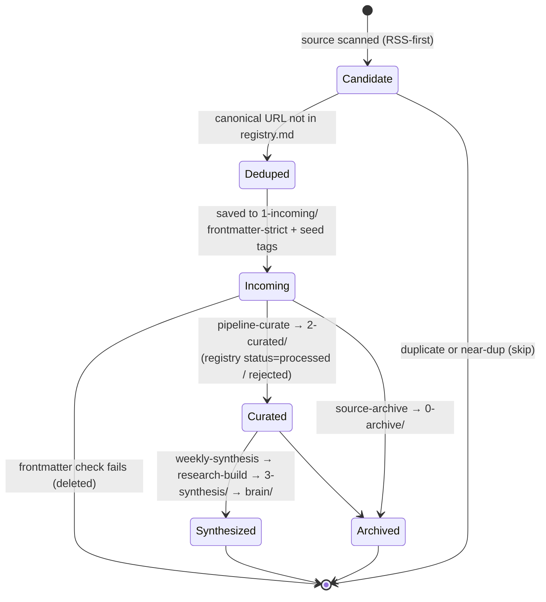
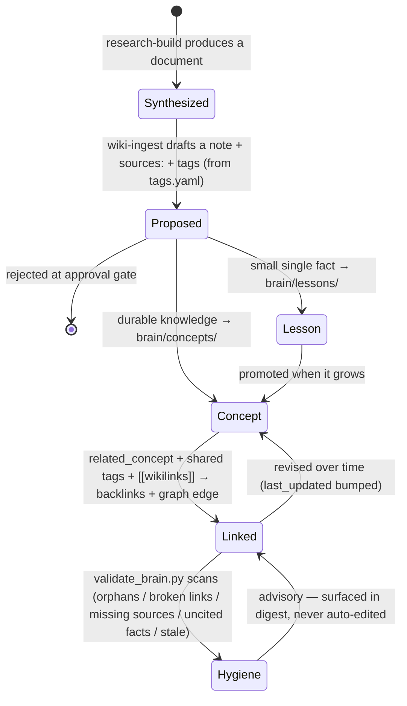
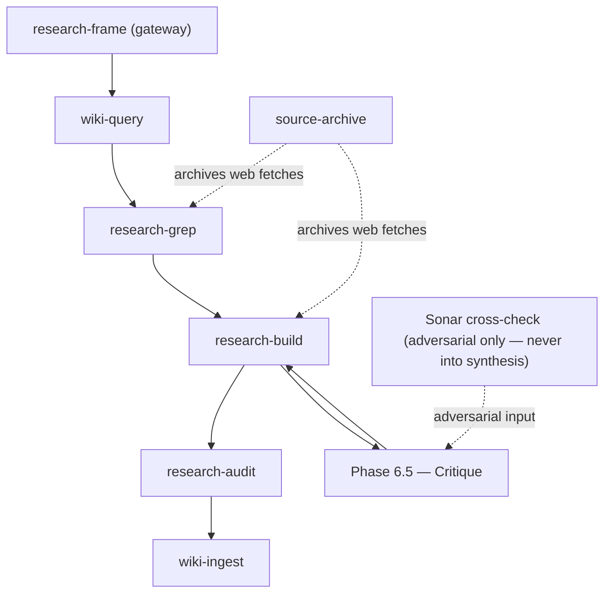
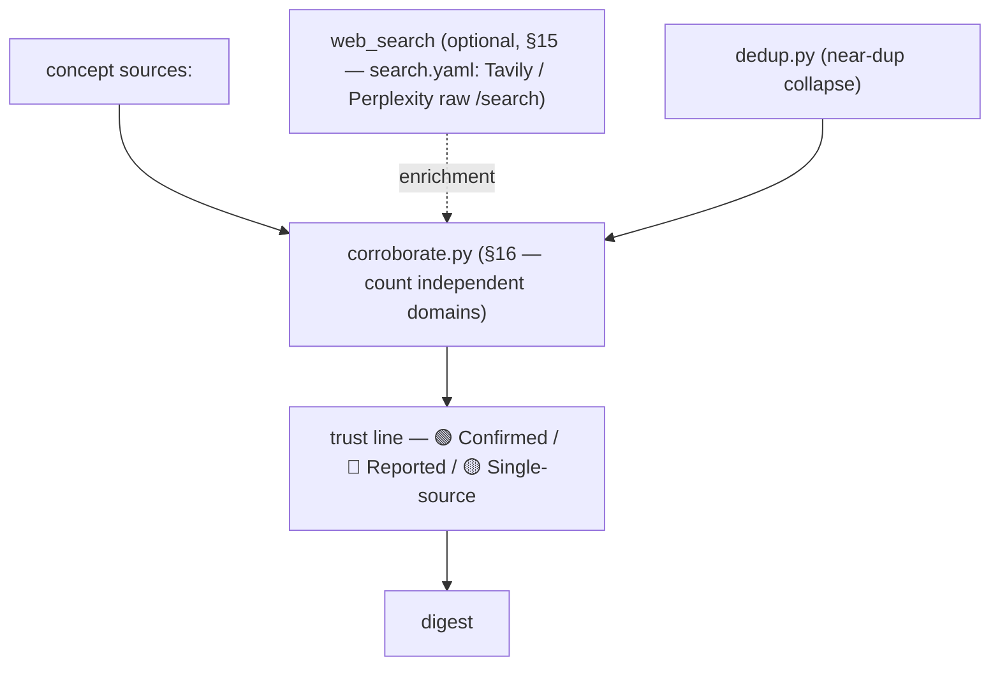

# Architecture

How research-brain is put together: the components, the data flow between them, and
which skill or script owns each stage. For day-to-day usage see
[../USER_GUIDE.md](../USER_GUIDE.md); for the path/schema contract see
[CONVENTIONS.md](CONVENTIONS.md).

The core system runs inside an agent runtime (**Cowork / Claude Code**) that executes
the skills and scheduled tasks. Knowledge is stored as an **Obsidian vault** (`brain/`).
There is no always-on server or database. An optional local stdio MCP adapter reads the
curated concept vault for connected agents; its SDK and environment are isolated from the
core Python runtime.

---

## Component / container view

```mermaid
flowchart TB
    subgraph CONFIG["config/ — user configuration"]
        SRC["sources.yaml"]
        TOP["topics.yaml"]
        TAG["tags.yaml (controlled vocab)"]
        AUTH["authors.yaml (followed authors, optional)"]
        CH["channels.yaml"]
        SCH["schedule.yaml"]
        SEA["search.yaml"]
        RES["research.yaml"]
        ENV[".env (secrets, gitignored)"]
    end

    SW["setup-wizard (skill)"] --> CONFIG

    subgraph SCRIPTS["scripts/ — Python helpers"]
        HC["collect.py (headless collector facade)"]
        COLL["scripts/collection/ (feed/text/article/fetch internals)"]
        MS["manage_sources.py (source config facade)"]
        SRCINT["scripts/sources/ (model/validation/markdown internals)"]
        VC["validate_config.py (config validator facade)"]
        VCI["scripts/config_validation/ (CLI/YAML/markdown/scans/feed internals)"]
        EVN["extract_vault_notes.py (lesson/playbook extractor)"]
        VB["validate_brain.py (hygiene)"]
        BS["brain_status.py (status facade)"]
        BSI["scripts/status/ (status models/source/cadence/digest internals)"]
        BD["build_digest.py (headless digest + audit/report)"]
        TR["trends.py (trends facade)"]
        TRI["scripts/trend_report/ (trends model/concept/metric/render internals)"]
        OPML["import_opml.py (OPML facade)"]
        OPI["scripts/opml_import/ (OPML model/parser/preview/CLI internals)"]
        INTAKE["intake.py (URL intake facade)"]
        INTAKEI["scripts/intake_flow/ (intake classify/evidence/topic/CLI internals)"]
        INBOX["inbox.py (capture queue facade)"]
        INBOXI["scripts/inbox_flow/ (inbox queue/registry/path/CLI internals)"]
        NU["normalize_url.py · dedup.py · claim_dedup.py"]
        MA["manage_authors.py (roster write path)"]
        AUTHI["scripts/authors/ (store/identity/plan/collect internals)"]
        DISC["discover.py + scripts/discovery/ (source proposals, read-only)"]
        SI["source_insights.py + scripts/source_report/ (journal → insights report)"]
        COR["corroborate.py (trust line)"]
        DEL["scripts/delivery/ (delivery facade + internals)"]
        SEARCH["scripts/search/ (search.py → tavily/perplexity/sonar/cross_check)"]
    end

    subgraph COLLECTION["Collection (RSS-first, scheduled)"]
        CB["collect-base.md (shared logic)"]
        CT["collect-topic.md (thin wrapper)"]
        CT --> CB
    end

    subgraph PIPELINE["pipeline/ — article stages"]
        REG["registry.md (URL dedup)"]
        INC["1-incoming/"]
        CUR["2-curated/"]
        SYN["3-synthesis/"]
        ARC["0-archive/"]
        INC --> CUR --> SYN
    end

    subgraph CURATION["Curation"]
        PC["pipeline-curate (skill)"]
        WC["weekly-curate.md (task)"]
        WC --> PC
    end

    subgraph SYNTHESIS["Synthesis (automatic)"]
        WS["weekly-synthesis.md (task)"]
    end

    subgraph RESEARCH["Research skills"]
        RF["research-frame"]
        RG["research-grep"]
        RB["research-build"]
        RA["research-audit"]
        SA["source-archive"]
        WQ["wiki-query"]
        WIN["wiki-ingest"]
    end

    subgraph HYGIENE["Brain hygiene (weekly-run)"]
        WR["weekly-run.md (orchestrator)"]
    end

    subgraph BRAIN["brain/ — Obsidian vault"]
        CON["concepts/ (sources + related_concept + tags)"]
        LES["lessons/"]
        PB["playbooks/"]
        MOC["INDEX.md (MOC fallback)"]
        BASE["*.base (Bases front doors)"]
    end

    subgraph DELIVERY["Digest & delivery"]
        WD["weekly-digest.md (task)"]
        DD["digest-deliver (skill, MCP mode)"]
        PY["scripts/delivery/deliver.py (headless facade)"]
        OUT["email · Telegram · Rocket.Chat"]
    end

    subgraph INTEGRATIONS["Optional integrations"]
        MCP["integrations/mcp_server<br/>local read-only stdio + research handoff"]
    end

    SRC --> CT
    TOP --> CT
    TAG --> CT
    SCH --> CT
    NU --> CB
    CB --> REG
    CB --> INC

    INC --> PC --> CUR
    CUR --> WS --> RB
    RF --> WQ --> RG --> RB --> RA
    SA -.archives fetches.-> ARC
    RB --> WIN --> CON
    WIN --> LES
    TAG -.closed-book tags.-> WIN
    WQ -.reads.-> MOC
    CON -.read-only retrieval.-> MCP
    RB --> SYN

    WR -.gates.-> WC
    WR -.gates.-> WS
    WR --> EVN
    EVN --> LES
    EVN --> PB
    WR --> VB --> CON
    WR -.gates.-> WD

    SYN --> WD
    INC --> WD
    CON --> WD
    CON --> COR
    SEARCH -.search enrichment.-> COR
    SEA --> SEARCH
    RES --> SEARCH
    COR -.trust line.-> BD
    COLL --> HC
    HC --> REG
    HC --> INC
    SRCINT --> MS
    MS --> SRC
    MS --> TOP
    MS --> TAG
    MA --> AUTH
    AUTHI --> MA
    AUTH -.followed authors.-> HC
    DISC -.proposals only.-> MS
    REG --> SI
    SI -.insights report.-> SYN
    VCI --> VC
    VC --> CONFIG
    BSI --> BS
    BS --> CONFIG
    BS --> SYN
    TRI --> TR
    TR --> REG
    TR --> CON
    OPI --> OPML
    OPML --> MS
    INTAKEI --> INTAKE
    INBOXI --> INBOX
    INBOX --> INC
    BD -.headless digest.-> WD
    WD --> DD
    CH --> DD
    ENV --> DD
    CH --> PY
    ENV --> PY
    DD --> OUT
    PY --> OUT

    CON --> BASE
    BRAIN --- OBS[["Obsidian graph + backlinks"]]
```

---

## Components & owners

| Component | What it does | Owned by |
|-----------|--------------|----------|
| **config/** | User configuration: sources, topics, `tags.yaml` (the controlled tag vocabulary), channels, schedule. Secrets in `.env`. | Written by `setup-wizard`; `tags.yaml` is machine-owned (promotion applied by `scripts/promote_tags.py`, seeded by `source-manage`); read by everything downstream. |
| **config/tags.yaml** | The FIXED controlled vocabulary: `domains: {domain → [topics]}` + `synonyms:` (alias → canonical) + `pending:` quarantine. Tags are nested `domain/topic`; `wiki-ingest` picks concept tags closed-book from here, and RSS `<category>` values normalize through `synonyms`. | Derived by `setup-wizard`; normalized/merged by `validate_brain.py` (advisory); pending→`domains:` promotion *applied* by `scripts/promote_tags.py`, seeded by `source-manage` |
| **scripts/collect.py + scripts/collection/** | Headless RSS Digest Lite collector. `collect.py` remains the stable CLI/import facade; `scripts/collection/` owns feed parsing, static text extraction, article rendering/tag seeding, registry URL helpers, and hardened fetching. | the headless cron path; split pattern documented in ADR 0021 |
| **scripts/manage_sources.py + scripts/sources/** | Deterministic source/topic config mutation backend. `manage_sources.py` remains the stable CLI/import facade; `scripts/sources/` owns source models, validation, markdown-table helpers, and tag-key parsing. | `source-manage`, `setup-wizard`, OPML import/configure flows; split pattern documented in ADR 0021 |
| **scripts/validate_config.py + scripts/config_validation/** | Config validator. `validate_config.py` remains the stable CLI/import facade; `scripts/config_validation/` owns CLI orchestration, channels/schedule YAML validators, optional YAML validators, markdown validators, placeholder/secret scans, and feed-liveness helpers. | config gate, doctor/setup checks; split pattern documented in ADR 0021 |
| **scripts/normalize_url.py · dedup.py · claim_dedup.py** | Collection & synthesis helpers: `normalize_url.py` produces the canonical-URL dedup key; `dedup.py` flags near-duplicates / syndication (`max(char-3gram-jaccard, token-jaccard) ≥ 0.7`); `claim_dedup.py` collapses repeated claims across reader extracts (ADR 0018, `research-build` Phase 2b). | the collect task; `research-build` |
| **scripts/manage_authors.py + scripts/authors/** | Author monitoring. `manage_authors.py` is the ONLY write path into `config/authors.yaml` (roster CRUD + the read-only `nodes` cross-reference against `brain/authors/`); `scripts/authors/` owns the roster store, the strict identity ladder (no fuzzy name matching), the per-variant collection plan, and warnings for staged `scholarly` authors and retired legacy `search` rows. New `search` entries are refused. | `author-manage`; `weekly-run.md` Step 1b |
| **discover-sources + scripts/discover.py + scripts/discovery/** | Proposes NEW sources for a topic: searches, groups candidates by site, drops what is already monitored, ranks aggregators last, returns ≤10 with the reason each surfaced. Read-only by construction — it cannot write config; an accepted candidate is handed to `source-manage`, which also sets the trust `tier`. | `skills/discover-sources` |
| **scripts/source_insights.py + scripts/source_report/** | Source Insights: which of the sources the user ALREADY has are earning their place. Reads the collection decision journal (CONVENTIONS §9.1) + the registry, and renders a static `source-insights_YYYY-MM-DD.report.html` with per-source yield/quiet signals and "worth following?" author suggestions. Suggests only — it cannot import the author write path (pinned by test). | operator-facing report; `brain-ask` context |
| **scripts/rotate_pipeline.py** | Bounded growth for pipeline artifacts (`weekly-run.md` Step 7.7, best-effort) — **moves, never deletes**: dated `3-synthesis/` artifacts older than `--keep-days` (90) move to `pipeline/0-archive/3-synthesis/`, and `.health/events.jsonl` is compacted past the same cutoff. Judged by the date in the filename / event `ts`, never mtime; `.delivered/` receipts and the per-topic sidecars are never touched. | `weekly-run.md` |
| **The unattended-safety trio: scripts/run_lock.py · synthesis_freshness.py · presend_review.py** | `run_lock.py` is the single-run lock (`pipeline/.run.lock`, cross-platform, no cross-host pid steal) that serializes the cron / agentic / Codex paths; `synthesis_freshness.py` is the content-hash re-synthesis trigger (and the stale digest-lead suppressor); `presend_review.py` is the deterministic pre-send backbone (injection-leak scan + cited-link resolution) behind the opt-in `digest-review`. The fourth member, the S1–S9 sanitizer, has its own row above. | `weekly-run.md` Steps 0 / 3 / 5.5 |
| **scripts/health_alert.py · scripts/feedback.py · scripts/value_metrics.py** | Operational feedback loops: `health_alert.py` pushes an opt-in DEGRADED alert (`weekly-run.md` Step 7.5 and the decoupled `schedule/health-watchdog.md`); `feedback.py` is the append-only reader-feedback event log behind `digest-feedback` ([feedback.md](feedback.md)); `value_metrics.py` is the read-only recurring-value report (receipt retention, registry yield, synthesis reuse, feedback counts). | `weekly-run.md`; `digest-feedback`; operator |
| **scripts/schema.py · state.py · version.py · setup_check.py · doctor.py** | Install-lifecycle helpers: `schema.py` stamps flat `schema_version` values and guards additive-only drift (ADR 0020); `state.py` relocates durable state via `RESEARCH_BRAIN_STATE_DIR`; `version.py` reads/compares the archive version for the shipped `update.sh` (refuses a silent downgrade, ADR 0019); `setup_check.py` produces the activation verdict the wizard ends on; `doctor.py` is the one read-only "is everything OK?" composite check. | `setup-wizard`; `update.sh`; the operator |
| **collect-base.md** | Shared collection logic (fetch, dedup, frontmatter-strict save, registry append). Not run directly. | `schedule/collect-base.md` |
| **collect-topic.md** | Thin per-topic wrapper: reads `config/` and invokes `collect-base` with resolved params. | `schedule/collect-topic.md` |
| **pipeline/registry.md** | URL dedup ledger — primary key is the URL; collect checks it before saving and appends after. | the collect task |
| **pipeline/1-incoming/** | Freshly collected, frontmatter-strict articles, one subfolder per topic. | the collect task |
| **pipeline/2-curated/** | Curated, kept sources (with per-topic `index.md`) feeding synthesis. | `pipeline-curate` |
| **pipeline/3-synthesis/** | Synthesized research documents, built digests, digest audit sidecars (`digest_*.audit.json`), optional static operator reports (`digest_*.report.html`), synthesis run logs, and per-topic synthesis sidecars. | `research-build`, `weekly-digest`, `weekly-synthesis`, `scripts/build_digest.py` |
| **pipeline/0-archive/** | Archived raw source captures (with content hash). | `source-archive` |
| **pipeline-curate** | The link between collection and synthesis: applies each topic's include/exclude rules + a min-length floor to `1-incoming/` articles, writes `2-curated/{topic}/index.md`, and marks promoted registry rows `processed`. Idempotent. | `skills/pipeline-curate` |
| **scripts/sanitize_incoming.py + scripts/sanitizer/** | The S1–S9 anti-injection sanitizer + gate (weekly-run step 2, before curate — every LLM-facing step reads the companions). `sanitize_incoming.py` remains the stable CLI/import facade; `scripts/sanitizer/` owns CLI parsing, sanitizer result models, deterministic S1–S9 rules engine, frontmatter/YAML-value sanitization, companion audit/hash integrity internals, and tree-level sanitize/gate operations. `sanitize` writes a stripped `sanitized/` companion next to each incoming article; `gate_tree` verifies every article has a *current* companion before synthesis reads it. | run by `weekly-run.md` (and `build_digest.py`, whose gate is fail-closed by default); split pattern documented in ADR 0021 |
| **research-frame → wiki-query → research-grep → research-build → research-audit** | The research chain: frame & route → look up the vault → grep the local corpus → synthesize a document → grade claims. | `skills/research-*` |
| **source-archive** | Persists any web fetch into the archive zone with frontmatter + sha256 + double-link; auto-hooks on fetches. | `skills/source-archive` |
| **brain/ (Obsidian vault)** | Durable knowledge — `concepts/`, `lessons/`, `playbooks/`, `authors/`. Concepts link via `related_concept:` frontmatter + shared tags (the graph is built from these) and carry `sources:` (anti-hallucination provenance). Author nodes (`type: author`) are backlink-only entities: the author↔concept link lives on the concept's `contributors:` field, so the author's "everything they wrote" view is the Obsidian backlink. The `*.base` files are live Obsidian Bases front doors; `INDEX.md` is the plain-markdown MOC fallback. | `wiki-ingest` writes, `wiki-query` reads |
| **integrations/mcp_server/** | Optional local read-only MCP adapter: bounded lexical search across the MOC and curated concept notes (≤1,000 files / 32 MiB scanned; ≤2 compact matches with excerpts), plus direct concept lookup. Matching fields and terms are shown; this is not semantic search and it creates no generated index. Results include source metadata, confidence, freshness status, and recorded gaps. `request_mode=research` labels results as context and hands incomplete/uncertain lookups to the host's existing research workflow; the adapter itself never searches the raw corpus or web. Saving requires explicit user intent and `wiki-ingest`. Its pinned SDK is installed in a separate environment; it is not imported by `scripts/`. | MCP-compatible project agents over local `stdio` |
| **brain/concepts.base** | Live Obsidian Bases view over `brain/concepts/` (groups by domain, sorts by `last_updated`, hides `seed`/`example`). The primary front door for concepts; needs Obsidian >= 1.7. | ships with the vault; auto-updates, zero gardening |
| **brain/lessons.base** | Live Obsidian Bases view over `brain/lessons/` for atomic facts and watchlist items, grouped by confidence. | ships with the vault; auto-updates, zero gardening |
| **brain/playbooks.base** | Live Obsidian Bases view over `brain/playbooks/` for reusable methods, grouped by review status. | ships with the vault; auto-updates, zero gardening |
| **concept-manage** | User-facing concept-vault CRUD (one intent/turn): create a **monitored** concept via interview, list, update (re-research), archive/restore (soft-delete, never hard-delete). Mechanical ops via `scripts/concept_manage.py`; create/update orchestrate `source-manage` + the research chain + `wiki-ingest`. | `skills/concept-manage` |
| **scripts/extract_vault_notes.py** | Deterministic lesson/playbook generator. Scans explicit `## Lessons` / `## Key lessons` and `## Playbook: ...` sections in concept notes, then writes only missing notes into `brain/lessons/` and `brain/playbooks/` with `schema_version: 1`, source-concept links, and carried provenance. Additive/idempotent: it never rewrites concepts or deletes vault notes. | run by `weekly-run.md` after synthesis and before `validate_brain.py`; can be run manually |
| **scripts/validate_brain.py** | Single brain-hygiene pass (no graph engine): flags orphan concepts (no graph links), orphan lessons/playbooks (no concept, parent playbook, source concept, or body wikilink), broken `[[concepts/...]]` links, concepts missing `sources:`, uncited `## Key facts` bullets, and stale (`last_verified + ttl_days`) notes; normalizes/merges tags and *recommends* pending→`domains:` promotion (≥3 notes) against `config/tags.yaml`. Advisory (never edits/deletes notes — `scripts/promote_tags.py` applies the recommended promotion); emits a one-line health headline into the digest. | run by `weekly-run.md` |
| **scripts/build_digest.py** | Deterministic, agent-free equivalent of `weekly-digest`: scans `1-incoming/` by `collected:` + `concepts/` by `last_updated` over `digest.lookback_days`, groups by topic, adds the latest `synthesis-run` + `brain-health` summaries, writes `digest_YYYY-MM-DD.md` plus the derived `digest_YYYY-MM-DD.audit.json` selection/provenance sidecar. Renders the full layout — volume header, TL;DR, KB-health line, vault front doors for lessons/playbooks, topic-badge source cards, concept cards with trust markers (via `corroborate.py`), synthesis paragraph, backlog (CONVENTIONS §17). With `--report`, also writes a local static `digest_YYYY-MM-DD.report.html` operator view with Stats, Audit source drilldown, Vault, Glossary, and Concepts tabs; delivery still sends the Markdown/transport render, not the report. `scan_incoming` prefers each article's *current* `sanitized/` companion over the raw text; the sanitize gate is fail-closed **by default** (opt out with `--allow-unsanitized` for fully-controlled feeds). Prints `QUIET_WEEK` when nothing new. | the headless cron path |
| **scripts/corroborate.py** | Derives the per-concept trust line from `sources:` — counts distinct registrable domains (near-dup syndication collapsed via `dedup.py`) → `🟢 Confirmed` / `🔵 Reported` / `🟡 Single-source` (CONVENTIONS §16). | called by `build_digest.py` |
| **scripts/brain_status.py + scripts/status/** | Read-only status/finding queries over the system's own state. `brain_status.py` remains the stable CLI/import facade; `scripts/status/` owns status record models, source-registry parsing, cadence parsing/rendering, digest listing, and latest-finding extraction. | `brain-ask`, `doctor`, `health_checks`; split pattern documented in ADR 0021 |
| **scripts/trends.py + scripts/trend_report/** | Deterministic weekly trends report. `trends.py` remains the stable CLI/import facade; `scripts/trend_report/` owns trends record models, concept scanning, metric builders, and Markdown rendering. | weekly trends embed/report path; split pattern documented in ADR 0021 |
| **scripts/import_opml.py + scripts/opml_import/** | OPML subscription import. `import_opml.py` remains the stable CLI/import facade and owns config mutation via `manage_sources`; `scripts/opml_import/` owns OPML models, safe parsing, preview construction, and CLI helper rendering/parsing. | setup/intake source import flows; split pattern documented in ADR 0021 |
| **scripts/intake.py + scripts/intake_flow/** | Unified plain-URL intake classifier. `intake.py` remains the stable CLI/import facade; `scripts/intake_flow/` owns result models, HTML/JSON-LD evidence extraction, URL/topic helpers, classification orchestration, CLI parsing, and human/JSON output rendering. | `intake` skill URL classification path; split pattern documented in ADR 0021 |
| **scripts/inbox.py + scripts/inbox_flow/** | Ad-hoc article capture queue for `source-capture`. `inbox.py` remains the stable CLI/import facade and compatibility monkeypatch bridge; `scripts/inbox_flow/` owns queue constants/default normalization, path guards, unique filenames, strict article frontmatter serialization, article/registry lookup, capture/route operations, and CLI orchestration. | `source-capture` queue and batch-processing path; split pattern documented in ADR 0021 |
| **scripts/health.py + scripts/health_checks/** | Operational health. `health.py` remains the stable CLI/import facade; `scripts/health_checks/` owns the CLI parser, verdict model, roll-up summary, report rendering, append-only event-log storage (`pipeline/.health/events.jsonl`, gitignored), event-derived signals (feed liveness, delivery status, run/gate-skip state), and artifact-derived signals (digest age, quiet registry topics). Written by `deliver.py`/`build_digest.py`; read by `brain-ask`'s health intent. | `python3 scripts/health.py report`; split pattern documented in ADR 0021 |
| **scripts/delivery/email_html.py** | Premium HTML email renderer: markdown digest → structured blocks → inline-styled, Gmail/Outlook-safe HTML (accent header, TL;DR callout, topic-badge pills, bordered quotes, dark-mode hint). | used by the email adapters |
| **weekly-digest.md** | Builds the digest from recent pipeline items + recent concepts, then hands off to delivery. | `schedule/weekly-digest.md` |
| **weekly-curate.md** | Thin scheduled wrapper that runs the `pipeline-curate` skill on `curate.cron` — owns no logic of its own. | `schedule/weekly-curate.md` |
| **weekly-synthesis.md** | Automatic synthesis driver: for every topic with ≥ `synthesis.min_sources_per_topic` curated sources and no fresh synthesis, runs `research-build` (internal-corpus) then `wiki-ingest` (unattended, no approval gate) to populate `brain/`. | `schedule/weekly-synthesis.md` |
| **weekly-run.md** | The recommended single orchestrator: runs the whole weekly pipeline in order — collect (always) → sanitize-incoming → curate → synthesis → extract lessons/playbooks → brain-hygiene → digest build → deliver — each step gated on the previous finishing, so curation and synthesis never read raw incoming content and the digest never reads a half-written `brain/`. Owns no logic; sequences existing tasks/skills. | `schedule/weekly-run.md` |
| **digest-deliver (skill)** | MCP-mode delivery: renders & sends per channel via MCP tools / webhook. | `skills/digest-deliver` |
| **scripts/delivery/deliver.py + scripts/delivery/** | Headless-mode delivery for cron. `deliver.py` remains the stable CLI/import facade; `scripts/delivery/cli.py`, `runtime.py`, `runtime_context.py`, `dispatch.py`, `receipt_flow.py`, `runtime_status.py`, `paths.py`, `model.py`, `config.py`, `quiet.py`, `receipts.py`, `constants.py`, `dry_run.py`, `channels.py`, `mcp.py`, `mcp_receipts.py`, and `health_log.py` own CLI parsing, runtime orchestration, lock/default-path handling, channel dispatch selection, receipt idempotency/persistence, final status calculation, delivery model types, config/secret helpers, quiet-digest detection, MCP receipt commands, and health logging, while the adapter modules send per channel. | delivery cron path; split pattern documented in ADR 0021 |

---

## Article lifecycle

An article moves through the pipeline stages. Collection is **RSS-first** (RSS body →
WebFetch top-up → static fetch → browser, only per a per-source allow-list). The persistent
cross-run dedup key is the canonical URL (`normalize_url.py`); the RSS `<guid>` is only for
in-run feed-item dedup. Near-duplicates are flagged by `dedup.py`. Collection, curation, and synthesis are all automatic on their cadences —
`pipeline-curate` promotes into curated, `weekly-synthesis` drives curated → synthesized
into `brain/` — and `weekly-run.md` chains them so the digest waits for synthesis.

A row is appended to `registry.md` the moment an article is saved to `1-incoming/`,
which is what makes the next scan skip it.

---

## Knowledge-note lifecycle

A fact distilled from sources becomes a linked, sourced note in the Obsidian vault. Each
concept carries `sources:` (provenance, anti-hallucination) and tags chosen closed-book
from `config/tags.yaml`; links are made via `related_concept:` frontmatter + shared tags,
not only inline `[[wikilinks]]`.

Once a note is **Linked**, it appears in the Obsidian graph view and is reachable via
backlinks, the live Bases front doors (`concepts.base`, `lessons.base`, `playbooks.base`),
and the `INDEX.md` MOC fallback —
which is where `wiki-query` starts the next lookup, closing the loop back into the research
chain. `validate_brain.py` runs as the brain-hygiene step of `weekly-run.md` and reports
vault health (orphans, broken links, missing `sources:`, uncited key facts, stale notes)
without mutating the vault.

---

## The research chain

The order-sensitive skill chain that turns a question into a sourced note. `research-frame`
is the gateway and runs first; each web fetch is auto-archived by `source-archive`. The
**Phase 6.5 Sonar cross-check** is an *adversarial input into the Critique step only* — it
sharpens the critique, it **never** flows into synthesis (CONVENTIONS §15a).

**Context-bounded reading (reader fan-out).** At **≥5 synthesis-bound sources**, `research-build`
(and the unattended `weekly-synthesis`) dispatch **reader subagents** — one per article, or per
cluster when many — that return compact **extracts** while the **main agent never loads full
article bodies**; synthesis runs in the main agent on the bounded extract set. Sanitize and URL
dedup stay deterministic scripts run before/after dispatch. This is what keeps a multi-source
research or a many-article weekly run inside the context window. Contract:
[`skills/research-build/references/reader-contract.md`](../skills/research-build/references/reader-contract.md);
rationale: [ADR 0012](adr/0012-reader-subagent-fanout-for-context-bounding.md).

---

## Search & corroboration (trust slots)

How a concept earns its trust line. `corroborate.py` counts distinct registrable domains in
`sources:` (near-dup syndication collapsed via `dedup.py`) and emits 🟢 Confirmed / 🔵 Reported /
🟡 Single-source into the digest. An optional `web_search` enrichment branch (§15, `search.yaml` —
Tavily / Perplexity raw `/search`) can add independent domains before the count.

> **Three distinct slots — do not conflate:** **§15 `web_search`** returns raw results
> (`{title,url,snippet}`) for domain counting; **§16 corroboration** is the deterministic domain
> count that renders the trust line; **§15a Sonar cross-check** is a *chat* call (`/chat/completions`,
> answer + citations) that feeds `research-build`'s Critique only — separate endpoint, separate
> purpose, never into synthesis or the trust line.
