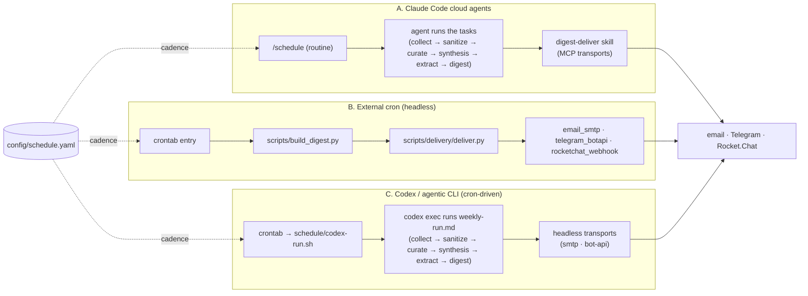

# Scheduling

How research-brain runs its collection and delivery on a cadence. There are a few ways to
automate it; all read the same cadence config. For the components involved, see
[architecture.md](architecture.md).

There are two capability levels:

- **Full agentic research brain (supported default):** an agent executes
  `schedule/weekly-run.md`, including model-dependent curation and synthesis into
  `brain/`.
- **RSS Digest Lite:** deterministic scripts collect RSS/Atom feeds with static article-page
  top-up for short entries, sanitize, build, and deliver a digest. This fallback does not
  independently perform the rich curation/synthesis that grows the vault.

They share configuration and durable state but are not feature-equivalent.
`python3 scripts/doctor.py` reports the active collection capability boundary, and
`python3 scripts/collect.py --dry-run` shows which active non-RSS sources are skipped
by the RSS-lite collector.

---

## Cadence config — `config/schedule.yaml`

All timing lives in one file. The schema is fixed (see [CONVENTIONS.md](CONVENTIONS.md)
§2.2); edit the values, not the keys. Cron syntax is `"min hour day month weekday"`.

```yaml
collect:
  cron: "0 9 */3 * *"          # every 3 days at 09:00 — scan sources, save new articles
  candidate_pool_per_topic: 25 # gather up to N candidates per topic across all roles…
  max_articles_per_topic: 10   # …then rank and read/save the best N (the saved cap)
curate:
  cron: "0 8 * * 1"         # Mondays 08:00 — promote 1-incoming -> 2-curated
  min_text_chars: 500       # relevance floor for a curation candidate
synthesis:
  cron: "30 8 * * 1"        # Mondays 08:30 — auto research-build + wiki-ingest into brain/
  min_sources_per_topic: 3  # curated sources a topic needs before it's synthesized
digest:
  cron: "0 9 * * 1"         # Mondays at 09:00 — build & deliver the digest
  lookback_days: 7          # include items collected in the last N days
timezone: "UTC"             # the timezone all cron times above are read in (e.g. "Europe/Minsk")
```

The component cadences are **collect** (ongoing, every 3 days), **curate**
(Mon 08:00), **synthesis** (Mon 08:30), and **digest** (Mon 09:00). The recommended
orchestrated order inserts sanitization before model-facing curation:
**collect → sanitize → curate → synthesis → extract lessons/playbooks → digest**.

> **Recommended:** run that whole weekly order in one gated pass via
> [`weekly-run.md`](../schedule/weekly-run.md) instead of four separate timers — see
> [The recommended way: one sequential run](#the-recommended-way-one-sequential-run) below.

| Key | Meaning |
|-----|---------|
| `collect.cron` | When the collection task runs. |
| `collect.candidate_pool_per_topic` | How many candidates to gather **per topic** before ranking (default 25). Gather wide. |
| `collect.max_articles_per_topic` | Cap on new articles read & saved **per topic** after ranking, each run (default 10). |
| `curate.cron` | When `weekly-curate` (the `pipeline-curate` skill) runs. |
| `curate.min_text_chars` | Minimum body length for a curation candidate to be kept. |
| `synthesis.cron` | When `weekly-synthesis` auto-synthesizes curated topics into `brain/`. |
| `synthesis.min_sources_per_topic` | Curated sources a topic needs before it's synthesized. |
| `digest.cron` | When the digest is built and delivered. |
| `digest.lookback_days` | How far back the digest looks for "new" items. |
| `timezone` | The timezone every `cron` time above is interpreted in. Optional; defaults to `"UTC"`. See [Timezone](#timezone) below. |

The `setup-wizard` writes this file from your answers; you can also edit it by hand.

---

## The scheduled tasks

The task definitions live in `schedule/`. Each is a plain-Markdown instruction set the
agent executes.

| Task | File | Cadence from | What it does |
|------|------|--------------|--------------|
| **collect** | `collect-topic.md` (+ `collect-base.md`) | `collect.cron` | Reads the sources/topics config (`config/sources.yaml` + `topics.yaml` — an unmigrated legacy `.md` install fails with the `migrate-config` pointer), scans active sources, dedups against `pipeline/registry.md`, and saves up to `max_articles_per_topic` frontmatter-strict articles per topic to `pipeline/1-incoming/{topic}/`. |
| **weekly-curate** | `weekly-curate.md` | `curate.cron` (Mon 08:00) | Thin wrapper that runs the `pipeline-curate` skill: applies each topic's include/exclude rules + `curate.min_text_chars` floor, promotes kept articles into `pipeline/2-curated/{topic}/index.md`, and marks promoted registry rows `processed`. Idempotent. |
| **weekly-synthesis** | `weekly-synthesis.md` | `synthesis.cron` (Mon 08:30) | Automatic synthesis driver: for every topic with ≥ `synthesis.min_sources_per_topic` curated sources and no fresh synthesis, runs `research-build` then `wiki-ingest` in unattended mode (no approval gate) to populate `brain/concepts/`. Logs each run to `pipeline/3-synthesis/`. |
| **weekly-digest** | `weekly-digest.md` | `digest.cron` (Mon 09:00) | Scans recent `pipeline/1-incoming/` items (by `collected:`) and recently updated `brain/concepts/` (by `last_updated`, excluding `SEED`/`EXAMPLE`) over the `lookback_days` window, adds a "Synthesis this week" summary, writes `pipeline/3-synthesis/digest_YYYY-MM-DD.md`, then hands off to the `digest-deliver` skill. The headless equivalent is `scripts/build_digest.py`. |
| **weekly-run** | `weekly-run.md` | one trigger at `digest.cron` | The recommended single orchestrator. Runs collect (always — per active topic) → sanitize-incoming → curate → synthesis → extract lessons/playbooks → **brain-hygiene** → digest build → deliver, each step gated on the previous finishing. Owns no logic — it sequences the tasks/skills above and stops on a failed step so a half-built `brain/` is never digested. |

### The thin-wrapper pattern (collect)

Collection is split into two files so the topic-specific values stay out of the logic:

- **`collect-base.md`** — all the shared logic (get a browser tab, load the registry,
  build the candidate list, dedup, fetch full text, save with strict frontmatter,
  post-write verification, append to the registry). It is **never run directly**; it takes
  parameters.
- **`collect-topic.md`** — a **thin wrapper** that sets one `{CATEGORY}`, reads that
  topic's sources/tags/filter/save-folder from `config/`, and then runs `collect-base`'s
  steps with those values substituted in.

To collect several topics, either run the wrapper once per topic (different `{CATEGORY}`)
or copy it per topic. The logic in `collect-base.md` is shared by all of them, so a fix or
improvement to collection is made in exactly one place.

---

## The recommended way: one sequential run

The four cron times above (`curate.cron` 08:00, `synthesis.cron` 08:30, `digest.cron` 09:00) are
wall-clock **timers**, not **dependencies**. If you register them as four independent jobs and
synthesis runs long, the 09:00 digest can start before synthesis has finished writing `brain/` —
a clock-race that ships a stale or half-built digest.

[`weekly-run.md`](../schedule/weekly-run.md) fixes this. It runs the whole weekly pipeline **in
order** — collect (always — per active topic) → sanitize-incoming → curate → synthesis → extract lessons/playbooks → **brain-hygiene** → digest (build) →
deliver — with **each step gated on the previous one finishing**. After synthesis has finished
writing `brain/`, it runs `python3 scripts/extract_vault_notes.py` to add explicit lessons and
draft playbooks from concept sections, then runs the single brain-hygiene pass
`python3 scripts/validate_brain.py`
(CONVENTIONS §13): an advisory scan for orphan concepts, broken `[[concepts/...]]` links,
concepts missing `sources:`, uncited `## Key facts` bullets, tag normalization, and stale notes.
It never edits the vault and always exits 0, writes
`pipeline/3-synthesis/brain-health_YYYY-MM-DD.md`, and its one-line headline is surfaced in the
digest. The digest is built only after synthesis (and the hygiene
scan) have finished; a failed step stops the run before the digest is built or sent.

This is the recommended way to run the weekly pipeline. Register **one** trigger for it:

- **Claude Code `/schedule`** — register a single cloud agent that runs `weekly-run.md`, scheduled
  at `digest.cron` (the end of the window, e.g. Mondays 09:00). One agent, gated internally.
- **External cron** — a single crontab entry that runs the sequence (see
  [B. External cron](#b-external-cron--headless-delivery)).

Writing `config/schedule.yaml` only defines the cadence; it does **not** register a
scheduler. First-run setup says `ready, schedule not registered` until you
register one recurring run for `schedule/weekly-run.md` at `digest.cron`. Registration is then
**detected, not asserted**: `scripts/setup_check.py` (and `scripts/doctor.py`'s
`Schedule` section) probe the local scheduler — a crontab / Task Scheduler entry that
references this install by absolute path — and report `Schedule: registered` on a match,
letting the overall setup become `complete`. Cloud-agent routines (Claude Code
`/schedule`) live off-box and cannot be probed; after you confirm one exists, pass the
explicit override `python3 scripts/setup_check.py --scheduler-state registered`.

The individual task files and their separate cron times remain available and supported for users
who deliberately prefer separate headless jobs (for example, running collect on its own box). If
you go that route, accept the timer-based ordering and leave enough gap between synthesis and
digest for synthesis to finish.

---

## Health alerts (opt-in)

The health verdict `/status` reads (see [`scripts/health.py`](../scripts/health.py)) is
**PULL-only** — someone has to look. To find out about a silently stopped or degraded
unattended run **without** checking, enable a **PUSH alert**: when the verdict is
**DEGRADED**, [`scripts/health_alert.py`](../scripts/health_alert.py) sends a one-line ping
through an already-configured delivery channel.

It is **opt-in (default OFF)**, so existing users are never suddenly messaged. The switch is
a small `alerts:` block under `delivery:` in `config/channels.yaml` — an `enabled` flag plus
which existing channel to alert through:

```yaml
delivery:
  alerts:
    enabled: true        # default OFF — omit the block (or set false) to disable
    channel: telegram    # which already-configured channel below to alert through
  telegram:
    enabled: true
    transport: bot-api   # the channel must be deliverable on the path you run (bot-api headless)
    chat_id: "..."
    token_env: TELEGRAM_BOT_TOKEN
```

- **What triggers it:** only **DEGRADED** — the actionable bad state (a failed weekly run, a
  dead/stale feed, a gate-skipped topic, an overdue run, a failed delivery, a stale digest).
  **OK / UNKNOWN / UNCONFIGURED do nothing** (a fresh or healthy system never pings).
- **The message** is a single line naming the degraded reasons, e.g.
  `⚠️ research-brain health DEGRADED: source unreachable: ...; run overdue (no recent run)` — an
  operator ping, not a digest.
- **Best-effort:** it reuses the existing delivery adapter for the chosen channel and **always
  exits 0**. A missing opt-in, a healthy verdict, or a send failure are reported on stdout but
  **never fail a cron run**.
- **Where it runs:** `weekly-run.md` runs it as a best-effort step right after recording the run
  (before releasing the lock), so a DEGRADED weekly run pings the operator. You can also run it
  from cron after the headless digest+deliver pair.

> **Recommended: also register the decoupled daily watchdog.** The Step 7.5 alert runs
> *inside* the weekly run — a run that crashed early, or a scheduler that silently stopped
> firing, alerts **zero** times. One extra independent trigger closes that gap (it pings only
> on DEGRADED, so a healthy week stays silent):
>
> - **Claude Code `/schedule`** — a second small daily routine pointed at
>   [`schedule/health-watchdog.md`](../schedule/health-watchdog.md).
> - **External cron** — one extra line:
>
>   ```bash
>   # Daily health watchdog — pings only on a DEGRADED verdict (opt-in via delivery.alerts):
>   0 10 * * *  cd /path/to/research-brain && .venv/bin/python3 scripts/health_alert.py
>   ```
>
> With the weekly chain's `health.py record --kind run` heartbeat (above), a dead weekly cron
> shows up as `run overdue` and this watchdog is what tells you about it.

Rehearse it without sending anything (prints the message it *would* send, or says there is
nothing to alert about on a healthy vault):

```bash
python3 scripts/health_alert.py --dry-run
```

---

## Registering it in one command

Writing `config/schedule.yaml` declares a cadence; it registers nothing — which is why an
install can sit at `Schedule: ready_schedule_not_registered` with everything else configured.
[`scripts/install_schedule.py`](../scripts/install_schedule.py) closes that gap: it renders
**this** install's crontab block from **its own** config (so `CRON_TZ` mirrors `timezone:`,
the weekly line runs at `digest.cron`, `%` is escaped, and every command names the install by
absolute path — which is exactly what `setup_check.py` probes for):

```bash
make schedule                          # write crontab-research-brain.txt (Claude path)
make schedule PATH_CHOICE=headless     # ...or the headless chain / codex
make schedule APPLY=1                  # ...and register it now
```

Registration **merges**: unrelated crontab entries survive, re-running does not duplicate,
and switching paths replaces the previous block rather than stacking a second one. Without
`APPLY=1` nothing is registered — it prints the exact merge command to run yourself. On
Windows use Task Scheduler (below); the generator is POSIX-cron only.

## Ways to run

Two transport families, plus a third trigger for the agentic family. **A** is the agentic
pipeline driven by a native cloud scheduler; **B** is the deterministic headless pipeline driven
by OS cron; **[C](#c-codex-or-any-agentic-cli-via-os-cron)** is the agentic pipeline (A's task
file) driven by OS cron — for Codex/Cowork and any agentic CLI without a cloud scheduler.



### A. Claude Code cloud agents — `/schedule`

Inside Claude Code, use the **`/schedule`** routine to register a recurring cloud agent
that runs a task. This is the richer path: the agent has MCP access, so `digest-deliver`
can use the Gmail / Telegram MCP transports (`provider: gmail-mcp`, `transport: mcp`) and
the full research chain is available. **It runs off-box**, though — if the install you want
driven is a local folder on your own machine, the routine cannot reach it; use path **D**
(the `claude-run.sh` cron wrapper) instead, which is the same agent CLI running locally. The automatic curate → synthesis steps need the agent's
MCP/research access, so this path is where the knowledge loop fills `brain/` unattended.

**Recommended:** register **one** agent that runs [`weekly-run.md`](../schedule/weekly-run.md)
at `digest.cron` (Mon 09:00) — it runs collect (always) → sanitize-incoming → curate → synthesis → extract lessons/playbooks → brain-hygiene → digest → deliver
in order, gated, so the digest waits for synthesis. `/schedule` agents interpret the cron time in
the `timezone` from `config/schedule.yaml` (see [Timezone](#timezone)); confirm that assumption
when you register the routine. If you instead want separate agents, point routines at the collect
task on `collect.cron`, curate on `curate.cron` (Mon 08:00), synthesis on `synthesis.cron`
(Mon 08:30), and digest on `digest.cron` (Mon 09:00) — mirror the values from
`config/schedule.yaml`.

### B. External cron — headless delivery

> 🔒 **Security — the sanitize gate is fail-closed by default here.** `build_digest.py` +
> `deliver.py` only **build and deliver what is already on disk** — the S1–S9 anti-injection
> *stripping* (`scripts/sanitize_incoming.py sanitize`) is a separate step (on the agentic
> paths, `weekly-run.md` Step 2 / Codex `codex-run.sh` run it for you). What the headless
> builder enforces is the **gate**: by default it refuses to build — non-zero exit, nothing
> written — unless every incoming article has a current sanitized companion, so a forgotten
> `sanitize` step can never silently ship un-sanitized incoming frontmatter into the digest.
> Run the `sanitize` step before building, as in the cron line below. For a feed set you
> fully control you may explicitly opt out with `--allow-unsanitized` and skip the sanitize
> step; the legacy `--require-sanitized` flag is accepted as a no-op reaffirming the default.

For a no-agent environment, drive the headless path with the OS scheduler. You need
**two** entries — a **collect** run that fills `pipeline/1-incoming/`, and the
**build+deliver** run that turns it into a digest. Without the collect entry
`build_digest.py` has nothing to scan and every digest is a permanent "quiet week":

```bash
# Every 3 days 09:00 (collect.cron) — scan sources, save new articles to pipeline/1-incoming/:
0 9 */3 * *  cd /path/to/research-brain && .venv/bin/python3 scripts/collect.py
# Mondays 09:00 (digest.cron) — sanitize incoming, build the digest (gate fail-closed by default), deliver, stamp the run heartbeat:
0 9 * * 1  cd /path/to/research-brain && .venv/bin/python3 scripts/sanitize_incoming.py sanitize && .venv/bin/python3 scripts/build_digest.py pipeline/3-synthesis/digest_$(date +\%F).md && .venv/bin/python3 scripts/delivery/deliver.py pipeline/3-synthesis/digest_$(date +\%F).md && .venv/bin/python3 scripts/health.py record --kind run --status ok
```

> **Why `.venv/bin/python3`, not `python3`.** Cron runs with a minimal `PATH`, so a bare
> `python3` resolves to the **system** Python — which typically lacks PyYAML, and
> `deliver.py` (and `build_digest.py`'s config readers) need it. The project venv
> (created by `install.sh` / `uv sync`) always has it. `collect.py` alone is stdlib-only,
> but keeping one interpreter across the entries avoids the trap entirely.
>
> **Why the trailing `health.py record --kind run`.** It stamps the run heartbeat only
> when the whole chain succeeded, so `health.py report` (and `health_alert.py`) can flag
> an **overdue run** on the pure-headless path too — otherwise a silently dead cron is
> caught only by the weaker `digest_stale` signal, days later.

Only for feeds you fully control — skip the sanitize step and opt out of the gate
explicitly:

```bash
# Fully-trusted-feed variant — no sanitize step, explicit opt-out of the gate:
0 9 * * 1  cd /path/to/research-brain && .venv/bin/python3 scripts/build_digest.py --allow-unsanitized pipeline/3-synthesis/digest_$(date +\%F).md && .venv/bin/python3 scripts/delivery/deliver.py pipeline/3-synthesis/digest_$(date +\%F).md && .venv/bin/python3 scripts/health.py record --kind run --status ok
```

`scripts/build_digest.py` is the deterministic, agent-free equivalent of the
`weekly-digest` task: it scans `pipeline/1-incoming/` by `collected:` and
`brain/concepts/` by `last_updated` over the `digest.lookback_days` window
(override with `--lookback N`), groups sources by topic, excludes `SEED`/`EXAMPLE`
concepts, adds a "Synthesis this week" summary from the latest
`synthesis-run_*.md`, and writes the `digest_YYYY-MM-DD.md` file that `deliver.py`
then sends. On a quiet week (no new sources, no concept updates) it writes a
one-line digest and prints a `QUIET_WEEK` marker on stdout, so the caller may skip
the delivery step. It resolves the project root regardless of cwd, so the cron line
above needs nothing pre-set. Pass `--require-synthesis-log` to make it **refuse to
build** unless a recent synthesis run log
(`pipeline/3-synthesis/synthesis-run_YYYY-MM-DD.md`, dated today or within a 1-day
grace for midnight rollover) exists — so a missing or partial
synthesis is never digested (default OFF, since the headless cron path builds without
the agent synthesis step). The sanitize gate is **on by default**: the build refuses
(non-zero exit, nothing written) unless every incoming article has a current sanitized
companion — it reuses the same S1–S9 `sanitize_incoming` gate the agentic `weekly-run.md`
runs at Step 2, so the headless path can't render un-sanitized incoming frontmatter into
the digest. An empty incoming tree passes trivially. Opt out with `--allow-unsanitized`
only for fully-controlled feeds.

### Optional daily "inflow" digest

For a lighter **daily** digest alongside the weekly one (ADR 0016), enable the
`daily_digest` block in `config/schedule.yaml` and register a second cron that builds with
`--daily` and delivers the daily file. The daily digest renders only `New sources` +
`Needs attention` (no synthesis), over a 1-day window by default, and writes a distinct
`digest_daily_YYYY-MM-DD.md` so it never collides with the weekly digest:

```bash
# Daily inflow digest — every day at 08:00 (weekly digest cron stays as above):
0 8 * * *  cd /path/to/research-brain && .venv/bin/python3 scripts/sanitize_incoming.py sanitize && .venv/bin/python3 scripts/build_digest.py --daily && .venv/bin/python3 scripts/delivery/deliver.py pipeline/3-synthesis/digest_daily_$(date +\%F).md --skip-quiet
```

A quiet day (no new sources, no attention items) writes a one-line `Quiet day —` digest and
prints the `QUIET_WEEK` marker; `deliver.py --skip-quiet` recognizes both the daily and
weekly quiet markers, so a "nothing new" day sends nothing. The single run lock serializes
the daily build against the weekly run safely.

### Optional weekly trends report

For an extended **weekly trends** report alongside the digest (ADR 0017), enable the
`weekly_trends` block in `config/schedule.yaml` and register a cron that builds with
`trends.py` and delivers the report. It answers "how is this changing?" — topic volume
this week vs last, rising tags, activity, and knowledge growth — reading only the
durable local sources (`pipeline/registry.md` + `brain/concepts/`), so it is
reproducible:

```bash
# Weekly trends report — Mondays at 10:00 (after the weekly digest):
0 10 * * 1  cd /path/to/research-brain && .venv/bin/python3 scripts/trends.py && .venv/bin/python3 scripts/delivery/deliver.py pipeline/3-synthesis/trends_$(date +\%F).md
```

`trends.py` writes `pipeline/3-synthesis/trends_YYYY-MM-DD.md` (override the path with a
positional argument). It resolves the project root regardless of cwd.

`deliver.py` reads the same `config/channels.yaml` and **auto-loads `config/.env`**
(resolved against the project root, regardless of cwd) before resolving secrets — so the
cron line above needs no manual `source` / `set -a`; just call the script. It delivers
each enabled channel through its adapter. **Important:** it only handles headless
transports — channels set to `provider: gmail-mcp` / `transport: mcp` are reported
`SKIPPED (MCP-only)` because they belong to the agent skill. For cron delivery, set email
to `provider: smtp` and Telegram to `transport: bot-api`, and put `SMTP_PASSWORD` /
`TELEGRAM_BOT_TOKEN` / the Rocket.Chat webhook key `ROCKETCHAT_WEBHOOK_URL` in
`config/.env`. It exits non-zero if any enabled headless channel fails.

`deliver.py` takes a few flags:

- `--force` — re-send even if a delivery receipt already exists (delivery is idempotent by
  default; a re-run skips channels already sent).
- `--skip-quiet` — no-op on a quiet-week digest (the one-line digest `build_digest.py` marks
  with `QUIET_WEEK`), so a week with nothing new sends nothing.
- `--rehearse` — build today's digest and dry-run-deliver it end-to-end (sends nothing).
- `--dry-run` — report targets and secret SET/MISSING status, send nothing.

Verify the channels resolve before the first scheduled send with a dry run — it sends
nothing and reports each channel's target and whether its secret is SET or MISSING:

```bash
python3 scripts/delivery/deliver.py --dry-run
```

> The cron schedule string must be kept in sync with `config/schedule.yaml` by hand —
> the YAML is the source of truth the tasks read; cron is just the trigger.

The line above is the **headless digest+delivery** step. To run the full gated weekly sequence
(`weekly-run.md`) headlessly, drive an agent capable of the curate/synthesis steps from one cron
entry — or, in a pure no-agent setup, run curate/synthesis as agent steps and keep the
deterministic `build_digest.py` + `deliver.py` line above as the final, gated digest step.

### B (Windows). Task Scheduler — headless delivery

Windows has no cron; use **Task Scheduler**. Register the same build+deliver step with
`schtasks` (run once in an elevated PowerShell). Use `uv run python` (not `python3`) and
PowerShell's date:

```powershell
schtasks /Create /TN "research-brain digest" /SC WEEKLY /D MON /ST 09:00 /TR `
  "powershell -NoProfile -Command \"Set-Location 'C:\path\to\research-brain'; `
   $d = Get-Date -Format yyyy-MM-dd; `
   uv run python scripts\sanitize_incoming.py sanitize; `
   if ($LASTEXITCODE -eq 0) { uv run python scripts\build_digest.py pipeline\3-synthesis\digest_$d.md }; `
   if ($LASTEXITCODE -eq 0) { uv run python scripts\delivery\deliver.py pipeline\3-synthesis\digest_$d.md }\""
```

(The `if ($LASTEXITCODE -eq 0)` guards replace the `&&` gating from the POSIX examples —
a bare `;` in Windows PowerShell 5.1 does **not** stop the chain when a step fails, and
`&&` only exists in PowerShell 7+.)

Task Scheduler fires in the machine's **local** timezone, so keep that equal to the `timezone`
in `config/schedule.yaml` (there is no `CRON_TZ` equivalent). Everything else — the channel
config, `--skip-quiet` / `--rehearse` / `--dry-run` flags, the receipts/lock behavior, and the
`RESEARCH_BRAIN_STATE_DIR` durable-state note below — is identical to the POSIX path.

### Headless collection — `scripts/collect.py`

The **collect** step is normally agentic (`collect-base.md` ranks a wide pool, scrapes JS
pages, writes LLM "Key takeaways"), so a pure no-agent box couldn't populate
`pipeline/1-incoming/` — leaving `build_digest.py` with nothing new to report. For that case,
`scripts/collect.py` is a **deterministic, stdlib-only** collector covering the cheapest rungs of
the RSS-first ladder (CONVENTIONS §12): active `rss` sources with RSS/Atom full bodies, plus
static article-page top-up when an entry is only a short summary. It reads the same
sources config (`config/sources.yaml` — an unmigrated legacy install fails with the
`migrate-config` pointer), dedups against `pipeline/registry.md` by normalized URL, writes the same
CONVENTIONS §5 strict frontmatter, appends the registry, and records source-health events —
exactly like the agent path, minus ranking, browser sources, search, and the LLM summary
(enrichment is left to curate/synthesis). Before writing, it also rejects long bodies that look
like paywall / consent / login walls or have too little article-like prose. It runs
**under the same run lock** as
`weekly-run` (so it never writes `1-incoming`/registry concurrently with an agent run — if a run
is already in progress it skips cleanly), caps saves per category at
`collect.max_articles_per_topic` (schedule.yaml, override with `--max-articles`), uses a separate
bounded static-top-up network budget derived from that cap, and writes each article atomically
(no half-written file is ever visible).

```bash
# Every 3 days at 09:00 (matches the shipped collect.cron in config/schedule.yaml):
0 9 */3 * *  cd /path/to/research-brain && .venv/bin/python3 scripts/collect.py
python3 scripts/collect.py --category ai-agents   # one category (interactive shell)
python3 scripts/collect.py --dry-run              # report counts, write nothing
```

It does **not** handle `blog` / `webpage` / `medium-tag` sources, browser/JS extraction,
ranking, or search collection — those still require the agent path. So a fully headless loop is:
`collect.py` (RSS plus static top-up) → `build_digest.py` → `deliver.py`, with curate/synthesis
run by an agent when you want concepts as well as raw sources in the digest.

---

### C. Codex (or any agentic CLI) via OS cron

Codex has no built-in cloud scheduler like Claude Code's `/schedule`, so you trigger it the
same way as the headless path (**B**) — from the OS scheduler — but pointed at the **agentic**
`weekly-run.md` instead of the Python scripts. This is the path that gives you the
LLM-dependent steps (collect ranking + the "Key takeaways" summaries, and synthesis) on a box
that runs Codex rather than Claude Code. Think of it as **path A driven by external cron**: same
gated task file, no native cloud agent. The thin wrapper
[`schedule/codex-run.sh`](../schedule/codex-run.sh) holds the invocation, so cron stays a
one-liner:

```bash
CRON_TZ=UTC                     # keep equal to config/schedule.yaml timezone
0 9 * * 1  /path/to/research-brain/schedule/codex-run.sh
```

The wrapper runs `codex exec` non-interactively against `schedule/weekly-run.md`:

```bash
codex exec --cd /path/to/research-brain \
  --sandbox workspace-write -c approval_policy=never \
  -c sandbox_workspace_write.network_access=true \
  "Execute schedule/weekly-run.md step by step, gated, exactly as written."
```

The wrapper supplies the write and network settings for this run. Collection needs
network access; a bare `codex exec` without those flags is not equivalent.

**Auth.** Codex authenticates either through a ChatGPT login (usage counts against the plan)
or an `OPENAI_API_KEY` (metered, fully headless). For unattended cron, the API key is the
portable choice — there is no interactive login to keep alive. Put it in `config/.env`
(`OPENAI_API_KEY=…`); it is an **optional** key, used only on this path, never referenced by
`config/channels.yaml`. A headless `claude` run uses `ANTHROPIC_API_KEY` the same way.
`codex-run.sh` reads that one key out of `config/.env` for you (an already-exported
`OPENAI_API_KEY` in the cron environment wins), so no extra sourcing is needed. The wrapper
also puts the project `.venv` first on `PATH` and refuses to start on a Python older than 3.11
— so the pipeline's bare `python3` steps get the locked interpreter, not a minimal-cron
system Python.

**Delivery.** Codex has no Gmail/Telegram MCP out of the box, so set delivery to the **headless
transports** — `provider: smtp` (email) and `transport: bot-api` (Telegram) in
`config/channels.yaml`, with `SMTP_PASSWORD` / `TELEGRAM_BOT_TOKEN` in `config/.env` — exactly
as for path B. (To get MCP delivery parity, register the same MCP servers under `[mcp_servers]`
in `~/.codex/config.toml`; that is more setup, so the headless transports are the simpler
default.)

**Per-role model tiering (optional).** Codex profiles let you put a cheaper model on the cheap
steps and the strong model on synthesis — the same cost lever as the Claude Code subagents
(`.claude/agents/`, ADR 0015). [`config/codex-profiles.example.toml`](../config/codex-profiles.example.toml)
ships the mapping: `rb-collector` / `rb-critic` / `rb-digest-maker` / `rb-deliverer` on a cheap
tier, `rb-synthesizer` on the strong tier (each a `model` + `model_reasoning_effort`). A profile
sets the model only — Codex has **no per-profile tool/MCP allowlist** like Claude Code subagents,
so on Codex the capability isolation is the S1–S9 sanitize gate, not the profile (moot for
delivery, which here is the headless `deliver.py` script, not an MCP tool). Apply it two ways:

- **Whole run at one tier** — set `CODEX_PROFILE` for `codex-run.sh`, e.g.
  `CODEX_PROFILE=rb-synthesizer /path/to/research-brain/schedule/codex-run.sh`. A single
  `codex exec` is one session on one model, so this picks one tier for the whole pipeline.
- **Real per-step tiering** — run the **component tasks as separate cron jobs** (the
  `collect`/`synthesis`/`digest` crons in `config/schedule.yaml`), each `codex exec -p rb-<role>`
  against its task file, so each step is its own session on its own model. See that example
  file's "Applying the profiles" for the per-file (v2) vs `[profiles.<name>]` (legacy) layout.

**Serialization is automatic.** `weekly-run.md` takes `scripts/run_lock.py` first (Step 0), so
a Codex run, a Claude `/schedule` run, and a cron `collect.py` can never interleave their writes
— a second runner that finds the lock held exits cleanly, which is not a failure. Set one shared
`RESEARCH_BRAIN_STATE_DIR` (below) across all of them so delivery-idempotency receipts are shared.

> **Cowork** uses the same skill/MCP model as Claude Code. If your Cowork runtime exposes a
> scheduler, point it at `weekly-run.md` exactly like path **A** (MCP delivery available). If it
> does not — or if the install it must drive is a **local folder** the scheduler cannot reach —
> drive it from OS cron: path **D** below is the Claude-CLI wrapper for exactly that case.

### D. Claude Code via OS cron — `schedule/claude-run.sh`

Path **A** registers a *cloud* routine. That is the right answer when the install is reachable
from the cloud agent — and the wrong one when it is a local, git-less folder on your own machine
(this doc already notes cloud routines "cannot be probed" by `setup_check.py` because they live
off-box; the same distance means they cannot read your `config/.env`, write your `brain/`, or
touch your delivery receipts). For that case use the same shape as the Codex path, with the
Claude Code CLI:

```cron
CRON_TZ=UTC
0 9 * * 1  /path/to/research-brain/schedule/claude-run.sh >> /tmp/rb-weekly.log 2>&1
```

[`claude-run.sh`](../schedule/claude-run.sh) runs `claude -p` (print mode — non-interactive)
against the same `weekly-run.md`, from the project root, with the same interpreter guard as the
Codex wrapper (both source [`schedule/_agentic-run.sh`](../schedule/_agentic-run.sh), so there is
one copy of that contract). **Advantage over path C:** MCP delivery works — if the session carries
the Gmail / Telegram MCP servers, `digest-deliver` can send through them, where Codex needs the
headless transports.

**Permissions — least privilege, not a bypass.** The wrapper pins three flags, and the split
between them is load-bearing:

| Flag | Role |
|---|---|
| `--tools` | The **hard bound** — which tools exist for the run at all. Set to the union of the pipeline-role allowlists in [`config/agents.yaml`](../config/agents.yaml) ([ADR 0015](adr/0015-least-privilege-role-subagents.md)), so an unattended run can do no more than the documented roles need. A tool withheld here is genuinely absent: the agent reports it has no such tool and the action does not happen. `tests/test_claude_run.py` derives the expected set from the YAML, so granting a role a new tool without widening the wrapper fails the gate. |
| `--allowedTools` | Pre-approval only — which of those tools may run **without asking**. It does not restrict; it prevents a cron run from waiting on a human. Tighten per install (e.g. `Bash(python3 *)`) if you want, but note an over-narrow rule makes a step *fail*, not prompt. |
| `--permission-mode dontAsk` | Answers permission questions without a TTY. Deliberately **not** `--dangerously-skip-permissions`: the run stays inside the allowlist instead of escaping the permission system. |

Two more properties worth knowing before you schedule it:

- **The cwd is the trust boundary.** Paths outside the project root are refused even for allowed
  tools, which is why the wrapper `cd`s to the root itself (the CLI has no `--cd`). Extra
  directories need `--add-dir`.
- **Your own Claude config still applies.** Settings and hooks from `~/.claude` are in force for a
  headless run — a `PreToolUse` hook that blocks a tool blocks it here too.

**Who pays — the subscription, unless you say otherwise.** An `ANTHROPIC_API_KEY` in the
environment silently outranks a claude.ai login, so an unattended run can bill API credits for
hours while a paid subscription sits unused. The CLI says so only obliquely ("connectors are
disabled because `ANTHROPIC_API_KEY` … takes precedence over your claude.ai login" — which reads
as a connectors notice, not a billing one), so the wrapper decides deliberately:

| `CLAUDE_RUN_AUTH` | Behaviour |
|---|---|
| *(unset)* / `auto` | **Default.** Probes for a claude.ai login and, when one exists, drops `ANTHROPIC_API_KEY` for the run — the subscription pays. With no login found, the key is kept and the run says so on stderr. |
| `api` | Keeps `ANTHROPIC_API_KEY`. The explicit opt-in to credit billing. |
| `subscription` | Drops the key without consulting the probe — the escape hatch when the probe misreports. |

The probe is a local `claude auth status` read: no API call, nothing billed. It runs with the key
already unset, because that is the only state that answers *"would a run without the key be logged
in?"* — with the key set, the CLI reports `authMethod: claude.ai` **and** a null
`subscriptionType`, which is too ambiguous to bill against. Its JSON shape is observed rather than
a documented API, so a failing or unrecognised probe **keeps the key and prints why**, instead of
guessing. Nothing here ever prompts: cron has no TTY, and a question would hang the weekly run.

Knobs, all optional and set on the crontab line: `CLAUDE_RUN_MODEL` (`--model`), `CLAUDE_RUN_EFFORT`
(`--effort`), `CLAUDE_RUN_MAX_USD` (the per-run spend ceiling, default 25 — an unattended agentic
loop bills real money, so the wrapper always passes one), and `CLAUDE_RUN_AUTH` above. Prerequisite:
`claude` must be authenticated for non-interactive use — verify with `claude -p 'say OK'` before
trusting it to cron. As with paths A–C, `weekly-run.md`'s run lock serializes this against every
other runner.

---

## Durable runtime state — `RESEARCH_BRAIN_STATE_DIR`

The pipeline keeps a small amount of **runtime state** that makes re-runs idempotent:

- the **delivery receipts** (+ the `.delivery.lock`) under `pipeline/3-synthesis/.delivered/`
  — the "already sent this digest to this channel" memory;
- the **health event log** at `pipeline/.health/events.jsonl` — the run history `/status` reads;
- the per-topic **synthesis-freshness sidecars** at
  `pipeline/3-synthesis/{topic}/.synthesis-meta.json` — the "this topic is already
  synthesized for the current corpus" memory;
- the **run lock** at `pipeline/.run.lock` — relocated too, so lock atomicity stays
  on the same filesystem as the state it guards.

By **default** these live in those gitignored, in-repo paths — no setup, nothing to
configure. That is fine for a checkout you keep. But on a **clone, redeploy, or
state-wipe** (e.g. a container with an ephemeral filesystem) that memory is lost, so in
the worst case a channel **re-sends a digest it already delivered**, or every topic gets
needlessly re-synthesized.

To survive that, point `RESEARCH_BRAIN_STATE_DIR` at a **persistent volume**:

```bash
# Relocate all four runtime-state subtrees onto a persistent volume.
export RESEARCH_BRAIN_STATE_DIR=/var/lib/research-brain/state
```

When set, the four subtrees relocate under it **preserving their relative substructure**
— e.g. `pipeline/3-synthesis/.delivered/` becomes
`$RESEARCH_BRAIN_STATE_DIR/pipeline/3-synthesis/.delivered/`. The repo itself can then be
wiped and re-cloned without losing the idempotency memory.

- **Default is in-repo.** Leaving the variable **unset** keeps every path exactly where it
  is today — there is no behavior change unless you opt in.
- Set it consistently for **all** entry points that touch this state — the headless
  `build_digest.py` / `deliver.py` cron pair and any `/schedule` agent — so they share one
  store. In a crontab, export it once near the top (alongside `CRON_TZ`); a `~` prefix is
  expanded.
- The volume only needs to be writable; the directories are created on first write.

---

## Timezone

Cron has no timezone of its own — `"0 9 * * 1"` means 09:00 in **whatever timezone the scheduler
runs in**. To make that explicit, `config/schedule.yaml` carries a `timezone` key (default
`"UTC"`; example `"Europe/Minsk"`). Every `cron` time in the file is meant to be read in that
timezone. How it is applied depends on which path you use:

- **Claude Code `/schedule` cloud agents** — the agent that runs the task is told to assume the
  `timezone` from `config/schedule.yaml`. When you register the routine, set its schedule in that
  same timezone so the registered time and the YAML agree. (Treat `timezone` as the documented
  assumption the routine must match — there is no automatic conversion between them.)
- **External cron** — the OS scheduler decides. Either set `CRON_TZ` at the top of the crontab so
  the entry is read in the intended zone, e.g.:

  ```bash
  CRON_TZ=Europe/Minsk
  0 9 * * 1  cd /path/to/research-brain && .venv/bin/python3 scripts/sanitize_incoming.py sanitize && .venv/bin/python3 scripts/build_digest.py ... && .venv/bin/python3 scripts/delivery/deliver.py ...
  ```

  …or set the box's system timezone (`TZ` / `timedatectl`) to match `timezone` and leave the
  entry plain. Either way, keep the crontab's effective timezone equal to the `timezone` in
  `config/schedule.yaml`.

`timezone` is optional and defaults to `"UTC"`; the validator checks it is a known IANA zone
(failing open on systems with no tz database, e.g. native Windows without `tzdata`). Nothing
reads it automatically — it documents the single timezone all the cron times share, so the
`/schedule` agent and your crontab can both be set to agree with it.

---

## On demand

You don't have to wait for a schedule. Ask the agent directly — "collect my topics now"
or "build and send the weekly digest" — and it runs the same task immediately. The
`run-now` skill is the on-demand conversational trigger for the whole `weekly-run.md`
pipeline (collect → sanitize-incoming → curate → synthesis → extract lessons/playbooks → brain-hygiene → digest → deliver) in one go. See
[../QUICKSTART.md](../QUICKSTART.md).
